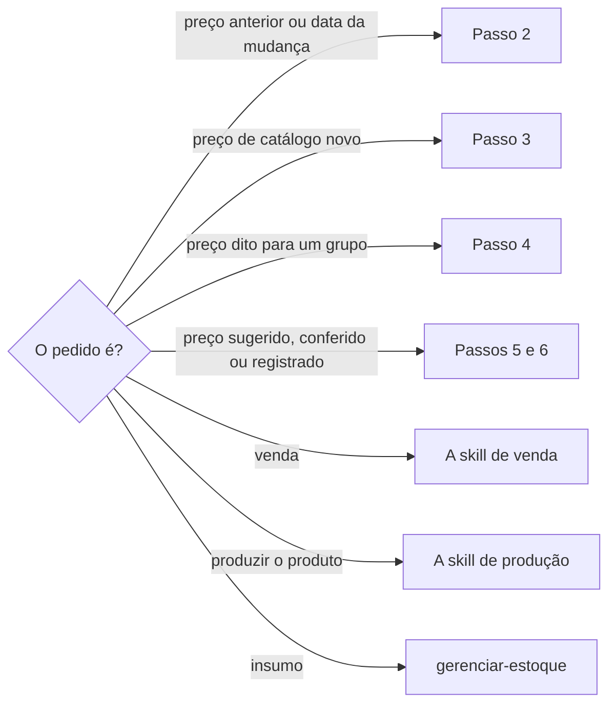

# Registrar preço de produto físico

## Parâmetros de configuração

Leia cada valor nas instruções do projeto: primeiro na entrada com o nome desta habilidade, depois na entrada `Global` ou no primeiro nível do bloco. Quando um valor não estiver lá, use o padrão abaixo.

```yaml
"Modo de aprendizado": "perguntar"
# Opções: `banco do Notion`, `Shopify` e `banco do Notion e Shopify`.
"Fonte do histórico de preços": "banco do Notion"
# Opções: `sempre`, `nunca`, `perguntar` e `automático`. `automático` lê as versões só quando a fonte do histórico não responde. O Notion não garante guardar as versões, então diga até onde chegam.
"Leitura do histórico de versões da página": "perguntar"
"Banco de variações": ""
# Nomes de banco e de registro: o projeto define. Banco vazio: use `procurar-banco-de-dados` antes de perguntar. Registro vazio: pergunte uma vez e não escolha.
"Banco de produtos": ""
"Banco do histórico de preços": ""
"Registro de mudança de preço no Shopify": ""
# Vazios: sem valor, pergunte à pessoa e não escolha.
"Destino do preço de um ponto de venda": ""
"Fonte do estoque por local": ""
# Terminação que fecha o preço quebrado, como `,90` em R$ 449,90. Só vale quando o Passo 5 aceita o preço quebrado.
"Terminação do preço quebrado": ",90"
# Valores em que o preço trava a compra, como 300 ou 500. Vazio: a habilidade não trata barreira.
"Barreiras psicológicas de preço": []
# Níveis da curva de preço do projeto. Vazios: pergunte à pessoa em que nível a peça está.
"Nível de entrada da curva de preço": ""
"Níveis acima da entrada": []
# O que pesa na justificativa do preço, como o programa de mentoria, a pirâmide de mix, a curva de preço e o posicionamento da marca. Vazio: justifique só com o que a pessoa e as fontes do projeto disseram, sem inventar critério.
"Fontes da justificativa do preço": []
```

## Instruções

### Passo 1

O produto fica em `Banco de produtos`. Os nomes das propriedades vêm do mapeamento de dados do projeto. `Banco de produtos` vazio: use `procurar-banco-de-dados`, dizendo que o banco guarda os produtos e seus preços.



### Passo 2

Antes de perguntar um preço anterior ou a data da mudança, leia a fonte do histórico, conforme `Fonte do histórico de preços`.

O que for anterior às linhas dessa fonte pode estar no histórico de versões da página, conforme `Leitura do histórico de versões da página`:

- `sempre`: leia a fonte e as versões da página.
- `automático`: leia as versões só quando a fonte não responde.
- `perguntar`: quando a fonte não responde, pergunte se lê as versões e espere.
- `nunca`: não leia as versões.

Leia as versões da página do produto e, se o preço varia por variação, as da variação pedida. `Banco de variações` vazio: use `procurar-banco-de-dados`. Não leia as da unidade.

O Notion não garante guardar as versões, então diga até onde chegam. Pergunte só o que nada respondeu e diga qual fonte consultou.

### Passo 3

Ao registrar uma mudança de preço de catálogo, acrescente uma linha na fonte do histórico. No banco do Notion, é uma linha em `Banco do histórico de preços`. No Shopify, é o `Registro de mudança de preço no Shopify` do produto. Com `Banco do histórico de preços` vazio, use `procurar-banco-de-dados`. Com o registro do Shopify vazio, pergunte onde acrescentar.

Nunca edite nem apague uma linha antiga: a correção vai numa linha nova.

Campos da linha, ligados às propriedades pelo mapeamento de dados do projeto:

- o produto, a variação quando o preço varia por ela, e o canal, varejo ou atacado;
- o motivo, obrigatório, e quem decidiu, obrigatório;
- o preço anterior e o novo;
- a vigência, a partir de que data;
- o custo na data, copiado no dia e nunca recalculado;
- o preço de comparação, que não passa do menor preço praticado nos 30 dias anteriores à redução.

Falta motivo ou quem decidiu: pergunte antes de acrescentar. Preço de comparação acima do limite: mostre o menor preço dos 30 dias e não acrescente.

### Passo 4

Um preço dito para um grupo, como "o grupo ficou por 250 no local", vale só para os produtos que estavam naquele local e ainda tinham estoque. O grupo é definido pelo estoque do local, não pelo nome.

Liste os produtos pela `Fonte do estoque por local` e tire os vendidos antes. Mostre a lista e espere a confirmação da pessoa. Produto que não foi ao local, ou que já saiu do estoque, não muda de preço.

Para listar o estoque, o banco de unidades precisa dar as unidades de um local e a finalidade de cada uma. Piloto, figurino e acervo não contam como estoque de venda.

### Passo 5

Ao sugerir, conferir, validar ou registrar um preço de venda, decida se ele é redondo, como R$ 450, ou quebrado, como R$ 449,90, antes de dar o número. A decisão parte da função que o preço precisa cumprir: sustentar valor percebido, autoria e desejo, ou favorecer conversão, entrada e comparação.

O padrão é o preço redondo. Ele serve quando a peça precisa comunicar coleção, presença, acabamento, confiança, marca, valor autoral ou desejo.

O preço quebrado só entra com uma justificativa clara, ligada a conversão, produto de entrada, campanha, saldo, condição especial ou barreira psicológica relevante. Quando for quebrado, termine em `Terminação do preço quebrado`.

Não termine todos os preços em `Terminação do preço quebrado` por hábito: cada peça passa pela decisão. Sem dado para saber a função da peça, pergunte antes de escolher o formato.

Peça central da coleção, de campanha, limitada, sob medida, conceitual, premium ou com narrativa forte pede preço redondo e seguro, que sustenta melhor o valor percebido. Evite o quebrado quando ele fizer a peça parecer promocional, massificada, varejista ou menos autoral. Se ainda assim recomendar o quebrado, explique objetivamente por que a conversão pesa mais que o valor percebido naquela peça. Preço quebrado sem essa explicação enfraquece a postura da marca e parece esconder o valor real da peça.

Porta de entrada da marca, acessório, item de menor risco para a primeira compra, produto de maior volume ou peça mais comercial pode ter preço quebrado, como R$ 89,90 ou R$ 299,90, quando isso reduz a barreira de compra. Diga que, nesses casos, o quebrado é ferramenta de conversão e não a linguagem principal de valor da marca. Confira se ele não entra em conflito com a posição da peça na curva de preço, na pirâmide de mix e no posicionamento da marca. Peça em `Níveis acima da entrada` reavalie se o redondo protege melhor a percepção de valor.

Peça em promoção, saldo de coleção, última peça, bazar, outlet, campanha com prazo, cupom, peça-piloto, drop anterior ou outra condição especial pode ter preço quebrado para comunicar oportunidade. Preserve, quando existir, a âncora de preço cheio, de preferência redonda, como "De R$ 450 por R$ 399,90". Não deixe o quebrado de campanha parecer o preço normal da peça. Registre se o preço é cheio, promocional, de saldo, de campanha ou de condição especial.

Preço calculado perto de um valor de `Barreiras psicológicas de preço`, como R$ 299,90 contra R$ 300, pede cuidado. Veja se a peça está numa faixa comercial em que reduzir a barreira ajuda a conversão, e evite essa lógica quando a peça precisa sustentar desejo, imagem, exclusividade, autoria ou percepção premium. Compare o ganho provável de conversão com o risco de reduzir o valor percebido, e diga por que o preço escolhido protege melhor a estratégia da peça e da coleção.

O preço também comunica posicionamento. Diga se o número escolhido comunica decisão, confiança e valor autoral, ou conversão, oportunidade e menor barreira de compra. Não recomende o quebrado só porque parece mais barato, sem ver se combina com a marca. Na dúvida, pergunte à pessoa: "esse preço precisa vender por impulso ou sustentar desejo?".

### Passo 6

Justifique todo preço que sugerir, conferir, validar ou registrar, na resposta e antes de atualizar o banco de produtos. Escreva como uma pessoa mentora, que orienta a decisão com senso crítico, clareza e visão de negócio, e não só devolve um número.

A justificativa explica por que o preço faz sentido para a peça, com os critérios que você de fato usou, como custo, markup, curva de preço, posição da peça na coleção, pirâmide de mix, complexidade produtiva, valor percebido, coerência comercial e posicionamento da marca. Leia o conhecimento de `Fontes da justificativa do preço`. Não cite como usado um critério que você não consultou, nem invente um que a fonte não traz.

Diga quais critérios pesaram mais. Não valide um preço sem isso.

### Passo 7

Onde registrar o preço de um ponto de venda é `Destino do preço de um ponto de venda`. Com ele vazio, pergunte à pessoa onde registrar e não escolha. `Fonte do estoque por local` vazia também se pergunta.

Não invente nome de banco nem de propriedade para o que o projeto não definiu: nenhum nome de banco entra nesta skill.

### Passo 8

Ao terminar, siga `evoluir-habilidade` conforme `Modo de aprendizado`.

## Problemas comuns

### Preço do grupo aplicado ao nome

Se você mudar o preço de todos os produtos com o nome citado, os que não estavam no local ou já tinham sido vendidos ficam com um preço que ninguém disse.

1. Liste os produtos pelo estoque do local.
2. Tire os vendidos antes.
3. Mostre a lista e espere a confirmação.

### Pergunta que a fonte respondia

Se você perguntar o preço anterior sem ler a fonte do histórico, a pessoa repete o que o registro já guarda.

1. Leia a fonte do histórico de preços.
2. Para o que vem antes dela, siga `Leitura do histórico de versões da página`.
3. Responda com o que achou e diga qual fonte consultou.
4. Pergunte só o que nenhuma responde.

### Linha antiga editada

Se você editar ou apagar uma linha do histórico, o registro deixa de provar o que mudou.

1. Acrescente uma linha nova com a correção.
2. Deixe a linha antiga como está.

### Preço sem justificativa

Se você devolver só o número, a pessoa não sabe o que pesou e não tem como discordar.

1. Escreva a justificativa antes de atualizar o banco de produtos.
2. Diga os critérios que você usou e quais pesaram mais.
3. Não valide o preço sem isso.

### Preço quebrado por hábito

Se você terminar todos os preços em `Terminação do preço quebrado`, a peça que precisava sustentar desejo passa a parecer promocional.

1. Pergunte qual função o preço cumpre.
2. Use o redondo quando a função for valor percebido, autoria ou desejo.
3. Use o quebrado só com a justificativa de conversão, entrada, campanha, saldo, condição especial ou barreira psicológica, e diga qual é.

## Exemplos de entrada e saída

Estes exemplos ilustram fatos. Eles podem não estar no data source.

### o grupo de camisetas ficou por 80 no evento

Listei as camisetas pelo estoque do evento e tirei as vendidas antes. Mostrei a lista e esperei o sim antes de mudar o preço. A camiseta que não foi levada não mudou de preço.

### qual era o preço da camiseta antes e quando mudou?

Li o banco do histórico de preços, que começa em março. A mudança era de janeiro, então li as versões da página, que mostravam o preço e a data. Disse até onde cada fonte chega e não perguntei nada.

### sugere o preço de uma peça autoral que custou 210

Sugeri R$ 450 em vez de R$ 449,90. A peça precisa sustentar valor autoral e desejo, e disse isso na resposta. Não usei o preço quebrado, porque nenhuma função de conversão o justificava.

### sugere o preço de um item de entrada que custou 40

Sugeri R$ 89,90. O item é a porta de entrada da marca, e o quebrado ajuda a reduzir a barreira da primeira compra. Disse essa função na resposta.

### sugere o preço de uma peça conceitual que custou 300

Sugeri R$ 690 e não R$ 679,90. A peça é conceitual e precisa sustentar autoria, e o quebrado a faria parecer varejista. Expliquei os critérios que mais pesaram: custo, posição na coleção e valor percebido.

### dá um preço de saldo para a peça de 450

Sugeri R$ 399,90 com a âncora "De R$ 450 por R$ 399,90". Registrei que é preço de saldo, para o quebrado não parecer o preço normal da peça.

### baixa o preço da caneca de 60 para 50

Perguntei o motivo e quem decidiu. Acrescentei uma linha com o canal, os preços, a vigência e o custo na data. Não editei a linha antiga.

## Casos-limite

- Nenhuma fonte chega até a mudança: diga qual consultou, até onde cada uma chega, e pergunte só o que ficou antes.
- A lista do grupo fica vazia: diga isso e não mude nenhum preço.
- A pessoa diz o preço de um produto só: confirme o produto e o preço antes de mudar.
- O preço fica a poucos reais de uma barreira, como R$ 300: confira se a peça precisa sustentar desejo antes de usar o quebrado.
- O preço é de saldo, campanha ou condição especial: registre isso e preserve a âncora do preço cheio.
- A função da peça não está clara, como entrada, campanha ou valor autoral: pergunte antes de escolher o formato do preço.
- O banco ou o workspace não está conectado: pare e peça.
- O destino do preço do ponto de venda está vazio: pergunte onde registrar.

## Pegadinhas

- O preço quebrado parece mais barato e por isso melhor. Em peça autoral ele a faz parecer promocional.
- O preço terminado em `,90` parece o padrão do varejo. Aqui o padrão é o redondo, e o quebrado precisa de uma função dita.
- O nome do produto parece o grupo inteiro. Quem define o grupo é o estoque do local.
- O preço dito no local parece valer para todos os produtos daquele tipo. Vale só para os que estavam lá e ainda tinham estoque.
- A página do produto parece só ter o preço de hoje. As versões do produto e da variação guardam preços antigos que o banco do histórico ainda não tem.
- O custo na data parece recalculável. Ele é o custo copiado no dia da mudança.
- O Notion lê o trecho entre dois cifrões sem barra como fórmula. Num texto com valor em reais, escreva `R\$ 10,00` e releia o campo depois de gravar. A propriedade numérica não precisa da barra.

## Scripts disponíveis

- Nenhum.

1. Não há script para executar.
