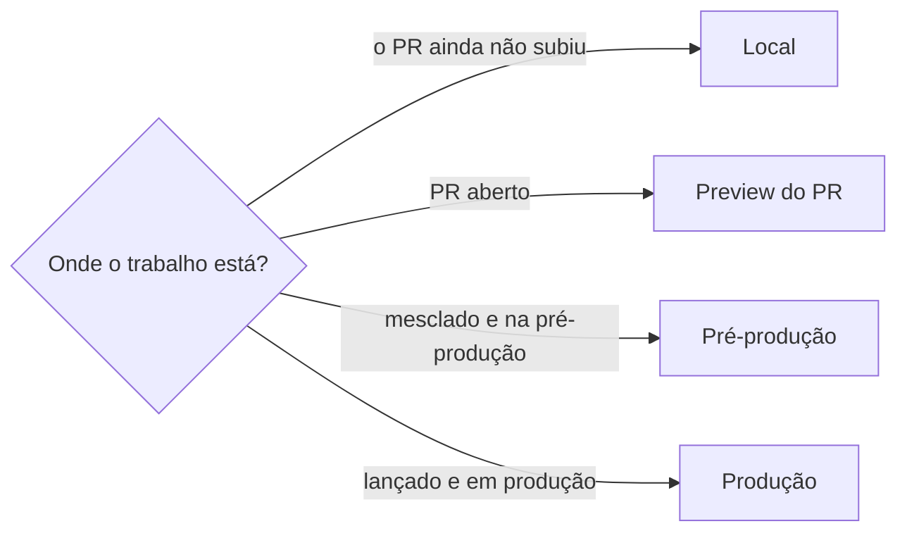
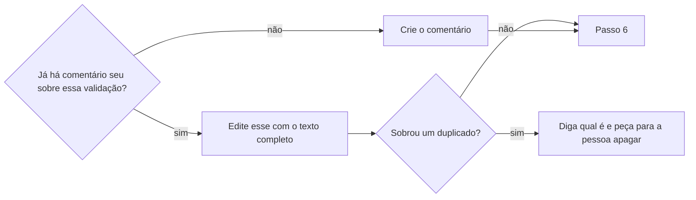

# Registrar resultados da validação na tarefa

## Parâmetros de configuração

```yaml
# `Idioma do comentário` é o idioma em que o comentário é escrito. Vazio usa o idioma da tarefa.
"Idioma do comentário": ""
# `Etapas` lista as etapas pelas quais a tarefa passa, na ordem. Cada uma tem os resultados da validação no ambiente onde o trabalho está.
"Etapas": ["Local", "Preview do PR", "Pré-produção", "Produção"]
# `Validações por etapa` lista o que se valida e se registra em cada etapa.
"Validações por etapa": ["testes unitários", "testes ponta a ponta", "evidência visual"]
# `Destinos do endereço do ambiente` lista onde o endereço do ambiente da etapa entra, em toda etapa depois da local.
"Destinos do endereço do ambiente": ["tarefa", "mensagem do Slack", "issue do GitHub", "descrição do PR"]
"Modo de aprendizado": "perguntar"
```

## Instruções

### Passo 1

Peça a tarefa e a etapa em que o trabalho está.
Veja a etapa pelos fatos, não pelo status da tarefa.



Leia os comentários da tarefa antes de escrever.
Se a tarefa tem um critério de aceitação sobre o registro da validação, o comentário o cumpre.

### Passo 2

Em cada etapa, repita as `Validações por etapa` no ambiente onde o trabalho está agora e registre o resultado de cada uma.
Na etapa local, a validação roda na cópia de trabalho, antes de o PR subir.
Nas etapas seguintes, ela roda contra o ambiente da etapa, e não contra o local.
A evidência visual segue `registrar-evidencia-visual`.
Cada resultado diz onde foi visto, com a pasta, a branch e o ambiente, como, quando e o que apareceu.
Escreva só o que você viu ou rodou. Hipótese e inferência saem marcadas como tais, com a frase "indício, não prova".
Antes de dizer onde ou quando um teste de CI roda, leia o gatilho do workflow.

### Passo 3

Depois da etapa local, cada etapa tem um endereço de ambiente: o preview do PR, a pré-produção ou a produção.
O endereço da etapa atual entra em todos os `Destinos do endereço do ambiente`.
Onde ele falta, ponha, ou diga o que falta.
A mensagem do Slack é escrita por `pedir-revisao-de-pr-no-slack`: aqui você só confere que o endereço entrou.
Sem preview publicado pelo projeto, diga isso. Não invente endereço.

### Passo 4

Escreva o comentário com uma frase de contexto, que diz quando e com o quê a validação foi feita, e uma seção por etapa já alcançada, na ordem de `Etapas`.
Em cada seção, ponha as validações da etapa, o resultado de cada uma e o endereço do ambiente.
Na última seção, "O que ainda não foi conferido", ponha o que falta, por quê e a contagem: quantas validações esperadas foram vistas passando.
Uma etapa nova entra como seção nova, e as anteriores ficam com os resultados que tinham.
Não escreva "sem regressão" nem "tudo funciona". Diga o que foi procurado e o que foi visto.
Escreva as horas no fuso da pessoa.

### Passo 5



Um resultado novo entra no mesmo comentário: mude a seção e a contagem.
A ferramenta de comentário edita o seu e não apaga nenhum.

### Passo 6

Releia o comentário publicado e confira que o texto e os links estão como você escreveu.
Se a descrição da tarefa ficou com uma frase que o comentário tornou velha, como "o passo manual ainda não foi feito", diga qual é e proponha a edição.
Devolva o link direto do comentário.

### Passo 7

Ao terminar, siga `evoluir-habilidade` conforme `Modo de aprendizado`.

## Problemas comuns

### Um comentário novo a cada resultado

Se você abrir outro comentário quando sai um resultado novo, a tarefa fica com duas versões da mesma conferência e a ferramenta não apaga.

1. Leia os comentários da tarefa antes de gravar.
2. Edite o seu com o texto completo, e não acrescente outro.
3. Se sobrar um duplicado, diga qual é e peça para a pessoa apagar.

### Ausência de regressão afirmada

Se você escrever que não há regressão, o comentário afirma o que ninguém procurou.

1. Troque pelo que foi procurado e pelo que foi visto.
2. Ponha o que não foi conferido na última seção.
3. Marque a inferência como indício, não prova.

### Resultado sem etapa nem ambiente

Se você registrar "passou" sem dizer a etapa, a pasta, a branch e o ambiente, o resultado pode ser do código antigo ou de outro ambiente.

1. Diga a etapa, a pasta, a branch e o ambiente.
2. Se um resultado já saiu de outro lugar, diga isso.
3. Rode de novo no lugar certo antes de registrar.

### Resultado de uma etapa registrado em outra

Se você registrar o resultado do ambiente local como se fosse do preview, ou o do preview como se fosse da pré-produção, o comentário comprova o que não foi testado ali.

1. Rode as validações no ambiente da etapa atual.
2. Registre cada resultado na seção da etapa onde rodou.
3. Se a etapa ainda não rodou, deixe na última seção.

### Endereço do ambiente fora de um destino

Se você registrar a validação mas deixar o endereço do ambiente fora da tarefa, da mensagem do Slack, da issue ou do PR, quem abre um deles não chega ao que foi testado.

1. Confira cada um dos `Destinos do endereço do ambiente`.
2. Ponha o endereço onde falta, ou diga o que falta.
3. Se o projeto não publica preview, diga isso em vez de inventar um endereço.

### Contagem que não bate

Se você escrever "todos passam" sem contar as validações esperadas, a contagem esconde o que não rodou.

1. Liste as validações esperadas da etapa.
2. Conte quantas foram vistas passando e quantas dependem de uma execução que ainda não houve.
3. Escreva "X de Y", e não "todos".

### Gatilho de CI de memória

Se você disser onde ou quando um teste roda sem ler o gatilho do workflow, o comentário afirma um portão que não existe.

1. Leia os gatilhos do workflow antes de escrever.
2. Diga se o teste roda antes ou depois do merge.
3. Se for depois, diga que antes só rodando local.

## Exemplos de entrada e saída

Estes exemplos ilustram fatos. Eles podem não estar no data source.

### registre a validação do card ABC-12, que está com o PR aberto e já tem um comentário meu da etapa local

Li os comentários do card ABC-12 e achei o meu, da etapa local. Editei esse comentário e acrescentei a seção "Preview do PR": os 2 testes de login rodados contra o endereço do preview, com o resultado de cada um, e a evidência visual do formulário. O endereço do preview estava na tarefa e na descrição do PR, mas faltava na mensagem do Slack e na issue do GitHub, e disse isso. A contagem passou de "3 de 5" para "5 de 5" na etapa. Não abri outro comentário e devolvi o link do comentário.

### a tarefa foi mesclada e está em pré-produção, registre a validação

A etapa é a pré-produção, e não a do preview. Rodei os mesmos testes ponta a ponta contra o ambiente de pré-produção e registrei numa seção nova, com o endereço dele e o resultado de cada teste. A seção do preview ficou como estava. O endereço da pré-produção entrou na tarefa, e conferi o resto dos destinos. O comentário não diz que não há regressão: diz o que foi procurado e visto, e deixa na última seção o que ainda não rodou.

## Casos-limite

- A tarefa não tem critério de validação: registre do mesmo jeito, com as mesmas seções.
- O comentário que já existe é de outra pessoa: a ferramenta só edita o seu. Abra o seu e diga que há outro.
- A validação foi feita por outra pessoa: escreva quem rodou e como você sabe, sem dizer que viu.
- Só uma parte das validações rodou: escreva "X de Y" e ponha o resto na última seção.
- O resultado antigo não existe mais, como um log que expirou: registre o que se viu e quando, com o link, e diga que o original expirou.
- A conferência exigiu uma conta de teste: diga "com a conta de teste", sem escrever login nem senha.
- A validação cria dados de verdade, como uma conta, numa etapa com dados reais: deixe na última seção como não conferida, com o motivo, até a pessoa rodar.
- O projeto não publica preview nem tem pré-produção: diga isso, valide as etapas que existem e não invente endereço.

## Pegadinhas

- A ferramenta de comentário edita o seu comentário e não apaga nenhum, nem o seu.
- Log de execução de CI e dado de teste expiram, e o preview pode deixar de existir depois do merge. Um comentário que só aponta para o endereço perde a prova: escreva o que se viu.
- O mesmo teste pode passar numa pasta e falhar noutra. O comentário sem a pasta não distingue.
- Um teste de CI que roda só depois do merge não é conferência de antes do merge.
- O endereço que vale é o da etapa atual. O da etapa anterior fica na seção dela, e não substitui o novo nos destinos.

## Scripts disponíveis

- Nenhum.

1. Não há script para executar.
