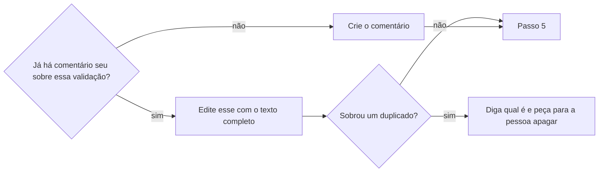

# Registrar validação na tarefa

## Parâmetros de configuração

```yaml
# `Idioma do comentário` é o idioma em que o comentário é escrito. Vazio usa o idioma da tarefa.
"Idioma do comentário": ""
# `Seções do comentário` lista os títulos das seções, na ordem. A primeira diz o que foi procurado e visto, a última diz o que não foi conferido.
"Seções do comentário": ["O que foi procurado e o que foi visto", "O que ainda não foi conferido"]
"Modo de aprendizado": "perguntar"
```

## Instruções

### Passo 1

Peça a tarefa e o que foi validado: o que mudou, onde e como a validação rodou, com que conta ou dados, e o resultado.
Leia os comentários da tarefa antes de escrever.
Se a tarefa tem um critério de aceitação sobre o registro da validação, o comentário o cumpre.

### Passo 2

Junte, para cada afirmação, onde ela foi vista, como, quando e o que apareceu.
Escreva só o que você viu ou rodou. Hipótese e inferência saem marcadas como tais, com a frase "indício, não prova".
Resultado de uma rodada diz de qual pasta, branch e ambiente veio.
Antes de dizer onde ou quando um teste de CI roda, leia o gatilho do workflow.

### Passo 3

Escreva o comentário com uma frase de contexto, que diz quando e com o quê a validação foi feita, e as `Seções do comentário`.
Na primeira seção, ponha a causa, a correção e o antes e o depois do mesmo teste.
Na última, ponha o que falta, por quê e a contagem: quantos dos testes esperados foram vistos passando.
Não escreva "sem regressão" nem "tudo funciona". Diga o que foi procurado e o que foi visto.
Escreva as horas no fuso da pessoa.

### Passo 4



Um resultado novo, como uma execução que faltava, entra no mesmo comentário: mude a seção e a contagem.
A ferramenta de comentário edita o seu e não apaga nenhum.

### Passo 5

Releia o comentário publicado e confira que o texto e os links estão como você escreveu.
Se a descrição da tarefa ficou com uma frase que o comentário tornou velha, como "o passo manual ainda não foi feito", diga qual é e proponha a edição.
Devolva o link direto do comentário.

### Passo 6

Ao terminar, siga `evoluir-habilidade` conforme `Modo de aprendizado`.

## Problemas comuns

### Um comentário novo a cada resultado

Se você abrir outro comentário quando sai um resultado novo, a tarefa fica com duas versões da mesma conferência e a ferramenta não apaga.

1. Leia os comentários da tarefa antes de gravar.
2. Edite o seu com o texto completo, e não acrescente outro.
3. Se sobrar um duplicado, diga qual é e peça para a pessoa apagar.

### Ausência de regressão afirmada

Se você escrever que não há regressão, o comentário afirma o que ninguém procurou.

1. Troque pelo que foi procurado e pelo que foi visto.
2. Ponha o que não foi conferido na última seção.
3. Marque a inferência como indício, não prova.

### Resultado sem origem

Se você registrar "passou" sem dizer de qual pasta, branch e ambiente o resultado veio, ele pode ser do código antigo.

1. Diga a pasta, a branch e o ambiente.
2. Se um resultado já saiu de outro lugar, diga isso.
3. Rode de novo no lugar certo antes de registrar.

### Contagem que não bate

Se você escrever "todos passam" sem contar os testes do critério, a contagem esconde o que não rodou.

1. Liste os testes esperados.
2. Conte quantos foram vistos passando e quantos dependem de uma execução que ainda não houve.
3. Escreva "X de Y", e não "todos".

### Gatilho de CI de memória

Se você disser onde ou quando um teste roda sem ler o gatilho do workflow, o comentário afirma um portão que não existe.

1. Leia os gatilhos do workflow antes de escrever.
2. Diga se o teste roda antes ou depois do merge.
3. Se for depois, diga que antes só rodando local.

## Exemplos de entrada e saída

Estes exemplos ilustram fatos. Eles podem não estar no data source.

### registre a validação da correção do login no card ABC-12, que já tem um comentário meu da validação em ambiente de teste

Li os comentários do card ABC-12 e achei o meu, da validação em ambiente de teste. Editei esse comentário com o texto completo: acrescentei o resultado dos dois testes de login rodados na pasta da correção e deixei na última seção o cadastro, que ainda não rodou. A contagem passou de "1 de 4" para "3 de 4". Não abri outro comentário, e devolvi o link do comentário.

### registre que o teste passou depois da correção

Não registrei ainda. Faltava dizer de qual pasta e de qual ambiente o resultado veio, e se o teste de antes rodou na mesma pasta. Perguntei isso, e só depois escrevi: antes da correção, 2 testes estouravam o tempo; depois, os mesmos 2 passam, no mesmo ambiente. O comentário não diz que não há regressão: diz o que foi procurado e visto.

## Casos-limite

- A tarefa não tem critério de validação: registre do mesmo jeito, com as mesmas seções.
- O comentário que já existe é de outra pessoa: a ferramenta só edita o seu. Abra o seu e diga que há outro.
- A validação foi feita por outra pessoa: escreva quem rodou e como você sabe, sem dizer que viu.
- Só uma parte dos testes rodou: escreva "X de Y" e ponha o resto na última seção.
- O resultado antigo não existe mais, como um log que expirou: registre o que se viu e quando, com o link, e diga que o original expirou.
- A conferência exigiu uma conta de teste: diga "com a conta de teste", sem escrever login nem senha.

## Pegadinhas

- A ferramenta de comentário edita o seu comentário e não apaga nenhum, nem o seu.
- Log de execução de CI e dado de teste expiram. Um comentário que só aponta para o log perde a prova: escreva o que o log mostrou.
- Um teste que cria dados de verdade, como uma conta, não vale rodar em produção só para registrar: diga que ficou sem rodar e por quê.
- O mesmo teste pode passar numa pasta e falhar noutra. O comentário sem a pasta não distingue.
- Um teste de CI que roda só depois do merge não é conferência de antes do merge.

## Scripts disponíveis

- Nenhum.

1. Não há script para executar.
