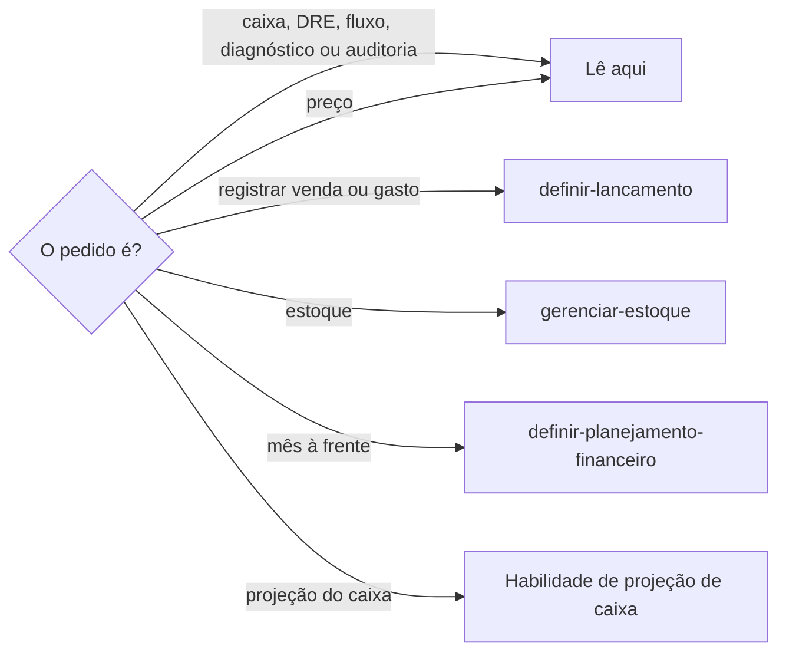

# Revisar finanças

## Parâmetros de configuração

Leia cada valor nas instruções do projeto: primeiro na entrada com o nome desta habilidade, depois na entrada `Global` ou no primeiro nível do bloco. Quando um valor não estiver lá, use o padrão abaixo. `Moeda` é a moeda das tabelas. `Habilidade de projeção de caixa` vazia quer dizer que a projeção do caixa fica fora desta habilidade.

```yaml
"Moeda": "BRL"
"Habilidade de projeção de caixa": ""
```

## Instruções

### Passo 1

Ler o caixa, o lucro ou prejuízo, a DRE, o fluxo de caixa, o diagnóstico, a auditoria ou o preço a partir do que já está lançado é esta habilidade. A pessoa informa o data source na execução. Sem essa indicação, use as listas do mapeamento de dados do projeto. Se ele não estiver no workspace conectado, pare. Não use a fonte de outro workspace. Não grave lançamento aqui.



### Passo 2

A leitura usa o que a fonte já tem. Não refaça os controles do zero e não invente venda, gasto, saldo ou margem. Dado que falta para a conta: pare e peça. A resposta começa por tabelas de entradas, saídas, saldos, resultados ou estoque, na `Moeda`. Depois vêm resumo curto, alertas e orientações práticas.

### Passo 3

Leia .agents/assets/templates/dre-simplificada.md quando for gerar a saída.

### Passo 4

Leia .agents/assets/templates/fluxo-de-caixa.md quando for gerar a saída.

### Passo 5

Diagnóstico, consultoria e auditoria saem quando a pessoa pede, e só com dado suficiente. A auditoria tem três partes: situação do negócio, problemas identificados e recomendações práticas. Cada problema diz qual é, por que é risco, qual impacto financeiro pode ocorrer e qual ação prática tomar. Sem dado suficiente, diga o que falta. Não preencha as três partes com estimativa.

### Passo 6

Preço de venda lê custos e despesas já lançados. Mostre margem, risco de prejuízo, pontos de atenção e sugestão de ajuste. Sugestão de preço pede a margem desejada. Sem ela, pergunte. Não invente a margem nem o custo. Explique como o preço se formou, o impacto no lucro e o cuidado na prática.

## Problemas comuns

### Número que a fonte não tem

Se você completar caixa, margem ou preço com um número que ninguém lançou, o diagnóstico nasce falso.

1. Leia a fonte.
2. Se faltar o dado da conta, peça.
3. Não invente venda, gasto, saldo, margem nem custo.

### Auditoria sem lastro

Se você escrever as três partes da auditoria sem dado suficiente, a recomendação não tem de onde sair.

1. Diga o que falta.
2. Não preencha situação, problemas e recomendações com estimativa.
3. Com dado suficiente, cada problema traz o risco, o impacto e a ação.

## Exemplos de entrada e saída

Estes exemplos ilustram fatos. Eles podem não estar no data source.

### como está o caixa?

Li o que já estava lançado. A tabela trouxe entradas, saídas e saldo, na `Moeda`. Depois vieram o resumo, o alerta e a orientação. Não gravei lançamento.

### monte a DRE e o fluxo do ano

A DRE saiu no modelo, com meses e total anual. O fluxo saiu no modelo, com saldo inicial, recebimentos, pagamentos, resultado do mês e saldo final acumulado. Célula sem fonte ficou vazia.

### sugira o preço desta peça

Não havia margem desejada. Perguntei. Não inventei o custo.

## Casos-limite

- A fonte não está no workspace conectado: pare. Não use a fonte de outro workspace.
- Registrar venda ou gasto: `definir-lancamento`. A lista de estoque: `gerenciar-estoque`. Mês à frente: `definir-planejamento-financeiro`. Projeção do caixa: a `Habilidade de projeção de caixa`, quando as instruções do projeto a indicarem.
- Sem dado para a margem: não calcule. Sem margem desejada: pergunte antes de sugerir o preço.
- Auditoria sem dado suficiente: diga o que falta. Não estime as três partes.

## Pegadinhas

- DRE simplificada parece outra conta. O modelo é a estrutura com meses e total anual. A explicação é que fica simples.
- A projeção do caixa parece este fluxo. Ela segue a `Habilidade de projeção de caixa`, quando as instruções do projeto a indicarem.
- Preço parece sair do custo sozinho. Sem a margem desejada, pergunte. Não invente.

## Scripts disponíveis

- Nenhum.

1. Não há script para executar.
