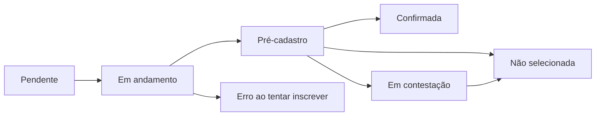

# Revisar inscrições

## Parâmetros de configuração

Leia cada valor nas instruções do projeto: primeiro na entrada com o nome desta habilidade, depois na entrada `Global` ou no primeiro nível do bloco. Quando um valor não estiver lá, use o padrão abaixo.
```yaml
"Modo de aprendizado": "perguntar"
```

## Instruções

### Passo 1

A lista de inscrições, o nome de cada propriedade e as opções de status vêm do mapeamento de dados do projeto, no workspace conectado. Se a lista não estiver nessa conexão, pare. Não use a lista de outro workspace. Se o mapeamento não tiver o status da inscrição, a edição, quem fez a inscrição ou os participantes, pare e diga qual falta. Não crie a propriedade.

Se a pessoa indicar uma inscrição, revise só ela. Sem indicação, varra a lista, das mais atrasadas para as mais adiantadas: pendente, em andamento, erro ao tentar inscrever, em contestação, pré-cadastro, confirmada e não selecionada.

### Passo 2

Em cada inscrição, confira o que o status pede.

| Status | Precisa ter |
| --- | --- |
| Qualquer um | A edição relacionada, quem fez a inscrição e os participantes |
| Em andamento ou acima | O dia e a hora do envio |
| Pré-cadastro ou confirmada | Os comprovantes |
| Confirmada | A data da confirmação |
| Não selecionada | O resultado da organização, lido em e-mail ou conversa e citado num comentário datado |

Confira também se a linha segue o modelo de inscrição: comprovante só na propriedade dos comprovantes, e status, data, código, número do pedido e valor fora das observações e do corpo. O título segue a sugestão de título da própria linha.

### Passo 3

Avance a inscrição um quadro do Kanban de cada vez, só quando há prova.



Pendente passa a pré-cadastro quando há comprovante, ou e-mail ou conversa que mostra o cadastro feito. Siga `procurar-email` e, sem resultado, `conversar-no-whatsapp`. Pré-cadastro passa a confirmada quando a organização confirmou, ou quando o ponto de contato da edição mostra a participação, como `procurar-inscricao` manda conferir. Grave o novo status seguindo `definir-inscricao`.

Pré-cadastro passa a não selecionada quando o e-mail ou a conversa traz o resultado de uma seleção sem a vaga. Em contestação passa a não selecionada só quando a organização confirmou a recusa. Grave seguindo `definir-inscricao`.

Sem prova, o status não muda. Erro ao tentar inscrever e em contestação não avançam sozinhos: vão para o relatório com o que falta decidir.

### Passo 4

Preencha um campo só quando a prova traz o valor, como o horário do envio que está no e-mail ou no comprovante. Não invente data, hora, pessoa nem comprovante. Antes de escrever um nome, siga `definir-grafia`.

O que a prova não resolve fica sem gravar. Leia os comentários da página antes e, se o mesmo pedido já está lá, não comente de novo. Se não está, comente o que falta, por que não gravou e qual decisão cabe a quem fez a inscrição, marcando essa pessoa. Sem oportunidade relacionada, procure a edição seguindo `procurar-oportunidade` e, se não existir, indique `criar-oportunidade`.

### Passo 5

Releia cada página gravada e confira o status e os campos contra o que você quis gravar. Não diga que gravou sem essa leitura.

Leia o modelo de saída `relatorio-de-inscricoes` quando for gerar a saída. Cada inscrição leva o link da página, o status antes e depois e o que falta.

### Passo 6

Ao terminar, siga `evoluir-habilidade` conforme `Modo de aprendizado`.

## Problemas comuns

### Avanço sem prova

Se você mover a inscrição para pré-cadastro ou confirmada porque o prazo passou, o Kanban mostra uma inscrição que ninguém fez.

1. Procure o comprovante, o e-mail e a conversa.
2. Sem prova, deixe o status e relate o que falta.
3. Siga `definir-inscricao` para gravar quando houver.

### Dado inventado

Se você preencher o horário do envio ou o participante porque o campo está vazio, a linha parece completa e o erro some da revisão.

1. Grave só o valor que a prova traz.
2. Deixe vazio o que a prova não traz.
3. Comente o que falta e marque quem fez a inscrição.

### Comentário repetido

Se você comentar a mesma falta em toda execução, a página enche de avisos e ninguém lê.

1. Leia os comentários antes de comentar.
2. Comente só o que ainda não foi pedido.
3. Diga no relatório as que seguem sem resposta.

## Exemplos de entrada e saída

Estes exemplos ilustram fatos. Eles podem não estar no data source.

### revise as inscrições pendentes

Varri a lista na ordem do Kanban. Duas pendentes tinham comprovante e foram para pré-cadastro. Uma pendente não tinha prova e ficou como estava. Uma em andamento não tinha a hora do envio, e comentei a falta marcando quem fez a inscrição. Entreguei o relatório com o link de cada página.

## Casos-limite

- A pessoa indica uma inscrição: revise só ela e não varra a lista.
- Há várias inscrições do mesmo evento: avance cada uma pela prova dela. A confirmação de uma não confirma as outras.
- A prova mostra o cadastro feito por outra pessoa: grave quem fez a inscrição só se a prova disser, senão comente.
- O mapeamento não tem um dos status do Kanban: pare e diga qual falta.
- A edição não existe: indique `criar-oportunidade` e não crie a inscrição.

## Pegadinhas

- Pendente é a pessoa ainda não ter feito a inscrição, não a organização ainda não ter respondido. Sem prova de cadastro, o próximo passo é inscrever, que esta skill não faz.
- Em contestação não é erro: a empresa contestou uma negativa e aguarda a organização. Não mude o status por conta própria.
- Não selecionada é a inscrição enviada que a organização não selecionou, inclusive na lista de espera. Inscrição que não chegou a ser enviada, como prazo perdido ou formulário travado, não é não selecionada, e a lista não tem status para ela: relate no relatório.
- A hora do envio é obrigatória na lista. `definir-inscricao` aceita gravar só o dia quando a pessoa não dá a hora, e a revisão ainda aponta a falta dela.
- O e-mail do participante, a data e o nome da edição e o link do formulário são cópias. Não se gravam.

## Scripts disponíveis

- Nenhum.

1. Não há script para executar.
