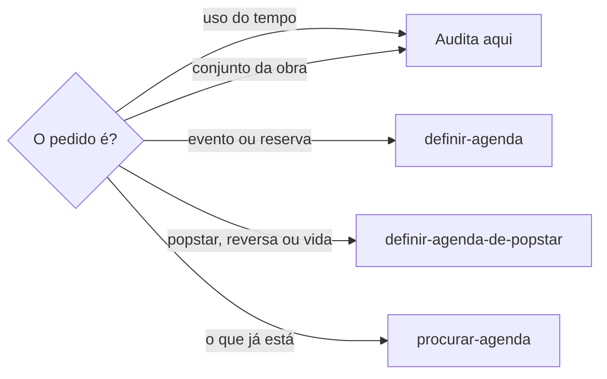

# Revisar uso do tempo

## Parâmetros de configuração

Leia cada valor nas instruções do projeto: primeiro na entrada com o nome desta habilidade, depois na entrada `Global` ou no primeiro nível do bloco. Quando um valor não estiver lá, use o padrão abaixo.

```yaml
"Apoio ao objetivo prioritário": mais da metade
```

## Instruções

### Passo 1

Auditar o uso do tempo ou avaliar o conjunto da obra é esta habilidade. Ela lê o Google Agenda e não grava o evento.



### Passo 2

A pessoa equilibra criação, visibilidade, receita e vida pessoal. Some os compromissos que o Google Agenda mostra. Diga se o tempo planejado alcança o apoio ao objetivo prioritário, e onde ajustar. Sem duração na agenda, peça. Não estime a fatia. Sem o objetivo prioritário, peça. Não escolha o objetivo. Antes de concluir que não consegue, confira Calendar Tools, Google Agenda, Notion Calendar ou equivalente nesta sessão. Não afirme que não há ferramenta sem essa checagem. Não pronta: inicie a conexão. Não responda só com instrução manual. Ativa: confirme e siga a auditoria original. Não peça para repetir o pedido. Falhou, indisponível ou ação fora do chat: explique o bloqueio e só então dê a alternativa manual. Não invente a semana.
Classifique cada compromisso pelo objetivo e pela área da vida que a pessoa ou a fonte já nomeou. Não atribua objetivo nem área que a fonte não trouxe. A ausência dessa classificação entra no achado. Aponte ausência, excesso e remarcação recorrente que o Google Agenda mostra. Não invente a contagem. Não remarque. A remarcação segue o flowchart, em `definir-agenda`.
A resposta leva um resumo curto, a proporção de compromissos alinhados, as lacunas por área, as remarcações recorrentes e os ajustes recomendados. Quando cita data ou horário, nomeia o fuso usado. A proporção sai dos compromissos que o Google Agenda mostra e que a fonte já alinhou a um objetivo. Não estime a proporção. O ajuste recomendado não grava o evento. Sem fuso, e se o dia puder mudar, peça. Não invente o fuso. O estado de cada evento gravado sai na resposta de `definir-agenda`.
Ação em massa: a resposta é uma tabela, uma linha por compromisso. As colunas são alinhamento, lacuna por área, remarcação recorrente e ajuste recomendado. A proporção resume a tabela. Não invente coluna.

## Problemas comuns

### Agenda sem checagem

Se você disser que não há ferramenta de agenda, ou só passar instrução manual, a auditoria morre com a ferramenta disponível.

1. Confira Calendar Tools, Google Agenda, Notion Calendar ou equivalente nesta sessão.
2. Não pronta: inicie a conexão. Ativa: confirme e siga a auditoria. Não peça para repetir.
3. Falhou ou ação fora do chat: explique o bloqueio e só então dê a alternativa manual.

### Fatia estimada

Se você estimar se o tempo alcança o apoio ao objetivo prioritário, ou escolher o objetivo prioritário, a auditoria nasce falsa.

1. Some só a duração que o Google Agenda mostra.
2. Use o objetivo prioritário que a pessoa ou a fonte nomeou.
3. Se faltar duração ou objetivo, peça. Diga onde ajustar.

### Conjunto inventado

Se você atribuir objetivo ou área da vida, ou inventar ausência, excesso ou remarcação recorrente, o conjunto da obra nasce falso.

1. Classifique só o que a pessoa ou a fonte nomeou.
2. Aponte só o que o Google Agenda mostra.
3. Não invente a contagem. Não remarque.

### Tabela com coluna a mais

Se você inventar coluna na ação em massa, ou estimar a proporção de compromissos alinhados, a auditoria nasce falsa.

1. Use uma linha por compromisso.
2. As colunas são alinhamento, lacuna por área, remarcação recorrente e ajuste recomendado.
3. A proporção resume a tabela. Não estime. Não grave o evento.

### Auditoria que grava

Se você criar ou alterar o evento para fazer a fatia caber, a auditoria vira planejamento.

1. Diga se o tempo alcança o apoio ao objetivo prioritário, e onde ajustar.
2. Grave o evento em `definir-agenda`.
3. A estrutura de carreira segue `definir-agenda-de-popstar`.

## Exemplos de entrada e saída

Estes exemplos ilustram fatos. Eles podem não estar no data source.

### Audite se minha semana está alinhada aos meus objetivos.

Somei criação, visibilidade, receita e vida pessoal só com o que o Google Agenda mostra. A resposta trouxe o resumo, a proporção de compromissos alinhados, as lacunas por área, as remarcações recorrentes e os ajustes recomendados. Onde a duração ou o objetivo faltou, pedi. Não estimei a proporção. Não gravei o evento.

### Quanto tempo foi dedicado a criação, comercial, comunicação e cuidado pessoal?

Somei só o que a agenda mostra. Onde a fatia não estava, pedi.

### Avalie o conjunto da obra desta agenda.

Classifiquei pelo objetivo e pela área da vida já nomeados. Medi a distribuição. Apontei ausência, excesso e remarcação recorrente que o Google Agenda mostra. Onde a classificação ou a duração faltou, a ausência entrou no achado. Não inventei a contagem. Não remarquei.

## Casos-limite

- Sem duração na agenda: peça. Não estime a fatia nem a proporção.
- Ação em massa: a resposta é a tabela com as quatro colunas. Não invente coluna.
- A resposta cita data ou horário sem fuso, e o dia pode mudar: peça o fuso. Não invente.
- Objetivo ou área da vida sem nome na fonte: a ausência entra no achado. Não atribua.
- Remarcação que o Google Agenda não mostra: peça. Não invente a contagem. Não remarque.
- Sem o objetivo prioritário: peça. Não escolha o objetivo.
- Ferramenta de agenda não pronta: conecte, confirme e siga a auditoria. Falhou: explique o bloqueio e só então dê a alternativa manual. Não afirme que não há ferramenta sem checar a sessão. Não invente a semana.
- O pedido é criar, revisar, alterar ou reservar o evento: pare e siga `definir-agenda`.
- O pedido é agenda de popstar, agenda reversa ou proteção de vida: pare e siga `definir-agenda-de-popstar`.
- O pedido é saber o que já está no dia ou na semana: pare e siga `procurar-agenda`.

## Pegadinhas

- A pergunta de quanto tempo parece pedido para estimar. O número sai da agenda. Se não estiver lá, peça.
- O número no meio do passo parece o lugar da edição. O valor mora no bloco `yaml` de `Parâmetros de configuração`.
- Auditar parece permissão para remarcar. A fatia fica aqui. O evento fica com `definir-agenda`.
- Afirmar que não há ferramenta de agenda parece fato. A checagem desta sessão vem antes.
- Área da vida parece lista para completar. Ela é a que a pessoa ou a fonte nomeou. A que falta é ausência, não um palpite.
- Vários compromissos parecem texto corrido. Ação em massa sai em tabela. A proporção resume a tabela.

## Scripts disponíveis

- Nenhum.

1. Não há script para executar.
