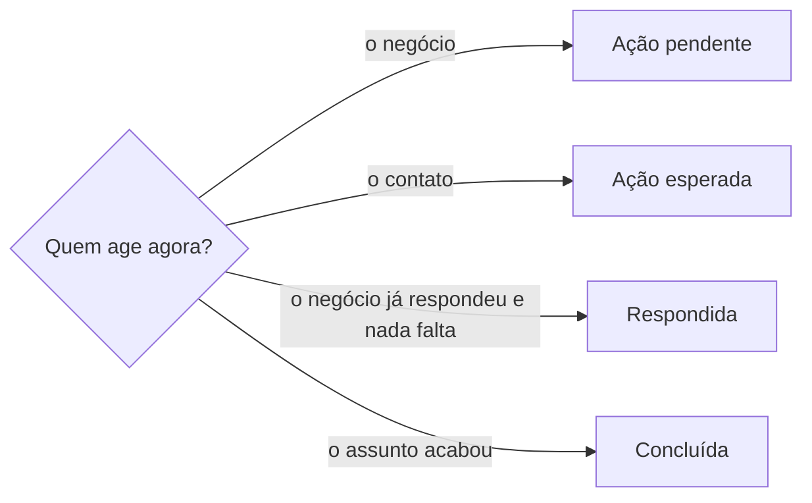

# Rotular item

## Parâmetros de configuração

Leia cada valor nas instruções do projeto: primeiro na entrada com o nome desta habilidade, depois na entrada `Global` ou no primeiro nível do bloco. Quando um valor não estiver lá, use o padrão abaixo. A habilidade de origem pode passar o próprio valor de cada chave, e ele vale mais.

```yaml
# `Criar rótulo que falta`: `sim` cria o rótulo escolhido que o sistema ainda não tem. `não` diz que ele falta e não aplica outro no lugar. Um rótulo de estado que a habilidade de origem exige é criado nos dois casos.
"Criar rótulo que falta": "não"
# `Etiquetas de status` e `Etiquetas de contexto` valem para toda habilidade que rotula conversa, no e-mail e no WhatsApp. O projeto define cada uma uma vez só, na entrada `Global`.
# `Etiquetas de status`: o rótulo de cada estado de uma conversa. Vazio, a conversa fica sem rótulo de estado.
"Etiquetas de status":
  "Ação pendente": ""
  "Ação esperada": ""
  "Respondida": ""
  "Concluída": ""
# `Etiquetas de contexto` lista os assuntos pelo caminho do e-mail, como `Áreas/Feiras`.
"Etiquetas de contexto": []
"Modo de aprendizado": "perguntar"
```

## Instruções

### Passo 1

Receba da habilidade de origem o item, o sistema em que ele fica, os rótulos que ela usa, o rótulo escolhido e o porquê da escolha.
A escolha é da habilidade de origem: esta habilidade não decide o assunto do item. Sem a escolha, volte para ela.
A lista de origem diz quais rótulos são de estado, como `blocked` ou `A pagar`, e quais pertencem a uma ferramenta que os aplica sozinha.

Toda conversa que uma habilidade leu ou respondeu, no e-mail ou no WhatsApp, passa por aqui antes de a habilidade terminar, com quem age agora e o contexto escolhido. Ela sai com o rótulo de estado e, quando o assunto tem um, com o de contexto. O estado sai de quem age agora, e o nome dele vem de `Etiquetas de status`:



O contexto é a escolha da habilidade de origem entre `Etiquetas de contexto`. Sem um que sirva, aplique só o estado e diga o contexto que falta, como proposta para o parâmetro. Use só rótulos desses dois parâmetros e não invente outro. Uma conversa que já tem os rótulos certos fica como está. Sem `Etiquetas de status` nas instruções do projeto, ou sem uma ferramenta que rotule o canal na sessão, diga quais conversas ficaram sem rótulo e por quê.

### Passo 2

Leia os rótulos que o sistema já tem antes de aplicar.
Um rótulo existente com o mesmo sentido do escolhido serve, mesmo com outra grafia: não crie um parecido.
Um rótulo de ferramenta não se aplica, não se tira nem se renomeia. Leia-o como sinal de que a ferramenta já processou o item.

No WhatsApp Business, o rótulo é uma lista, aplicada à conversa e, quando o WhatsApp deixa, à mensagem. A lista não tem hierarquia: use o último nível do caminho que a habilidade de origem passou, com o mesmo nome. O número de listas é limitado: antes de criar, conte as que existem e, quando a lista nova não couber, diga isso e não apague outra no lugar. Crie só a lista que a habilidade de origem passou, nunca uma de conta própria.

### Passo 3

Rótulo de estado que a lista de origem exige e o sistema não tem: crie-o, com a descrição do estado.
Outro rótulo que falta só é criado com `Criar rótulo que falta` em `sim`. Com `não`, diga na resposta que ele falta e não aplique outro no lugar.
Quando a habilidade de origem exige esse rótulo para criar o item, como o rótulo do tipo de um pull request, o item não é criado sem ele, nem a pedido.
Diga qual rótulo falta e proponha criá-lo e ligá-lo à regra que rotula sozinha, quando o sistema tem uma, como um script que rotula pelo título.
Crie o item só depois que o rótulo existir.

### Passo 4

Aplique o rótulo na mesma operação que cria o item, quando o sistema permite, como na abertura de um pull request. Não crie o item para rotular depois.
Um item que já existia sem rótulo recebe o rótulo antes de qualquer outra edição.

### Passo 5

O rótulo de estado acompanha o estado. Quando o estado muda, como um bloqueio que sai ou uma conta que foi paga, troque o rótulo na mesma rodada, sem deixar o antigo junto do novo.

### Passo 6

Leia o item de volta e confira os rótulos salvos.
Na resposta, diga os rótulos aplicados, os tirados e os que faltaram.

### Passo 7

Ao terminar, siga `evoluir-habilidade` conforme `Modo de aprendizado`.

## Problemas comuns

### Rótulo duplicado

Se você criar o rótulo escolhido sem ler os que existem, o sistema fica com dois rótulos do mesmo sentido, e a busca por um deles perde os itens do outro.

1. Leia os rótulos do sistema antes de aplicar.
2. Use o existente com o mesmo sentido.
3. Crie só o que falta, conforme o Passo 3.

### Estado velho no item

Se você aplicar o rótulo novo de estado e deixar o antigo, quem filtra pelo antigo acha que o item ainda está nele.

1. Tire o rótulo do estado anterior na mesma rodada.
2. Leia o item de volta.

### Item criado sem o rótulo exigido

Se você criar o item porque a pessoa pediu, sem o rótulo que a habilidade de origem exige, a checagem que confere o rótulo falha e a pessoa vê um erro que você já previa.

1. Pare antes de criar o item.
2. Diga qual rótulo falta e proponha criá-lo e ligá-lo à regra que rotula sozinha.
3. Crie o item só com o rótulo aplicado.

### Conversa sem rótulo

Se você ler ou responder uma conversa e terminar sem rotular, ela some do filtro de estado, e ninguém vê que o contato espera ou que a resposta chegou.

1. Receba da habilidade de origem quem age agora e o contexto.
2. Aplique o estado de `Etiquetas de status` e o contexto de `Etiquetas de contexto`.
3. Leia a conversa de volta e diga os rótulos na resposta.

### Item aberto sem rótulo

Se você criar o item e só depois escolher o rótulo, ele fica um tempo sem rótulo, e quem filtra não o vê.

1. Receba a escolha antes de criar o item.
2. Aplique na mesma operação que o cria.

## Exemplos de entrada e saída

Estes exemplos ilustram fatos. Eles podem não estar no data source.

### O PR só pode ser mesclado depois de guardar o segredo do app de release

`criar-pull-request` escolheu `enhancement` e `blocked`. O repositório não tinha `blocked`, que é rótulo de estado, então o criei. O PR abriu com os dois, e a leitura de volta mostrou os dois.

### O segredo foi guardado e o PR pode ser mesclado

Tirei `blocked` do PR e mantive `enhancement`. A leitura de volta mostrou só `enhancement`.

### Abra o PR que força a versão da release

`criar-pull-request` pediu o rótulo do tipo `chore`, que o repositório não tinha, e o script que rotula pelo título não ligava esse tipo a nenhum rótulo. Não abri o PR: disse que o rótulo faltava e propus criá-lo e ligar `chore` a ele no script.

### A conta do e-mail foi paga

`organizar-emails` mudou o estado da conta. Troquei `Áreas/Finanças/A pagar` por `Áreas/Finanças/Pago` na mesma conversa, e a conversa ficou só com a etiqueta nova.

### Mensagem enviada a um contato no WhatsApp

`conversar-no-whatsapp` enviou a pergunta sobre as datas e passou a conversa com o contato agindo agora e o contexto das feiras. Apliquei a lista de ação esperada e a lista das feiras pelo Adicionar à lista. A leitura de volta mostrou as duas.

## Casos-limite

- A habilidade de origem não mandou a escolha: volte para ela. Não escolha pelo assunto do item.
- O sistema não deixa rotular na criação: crie o item e aplique o rótulo logo em seguida, antes de qualquer outra edição.
- O rótulo escolhido é de uma ferramenta: não o aplique e diga isso na resposta.
- O pedido é uma hashtag ou uma categoria de conteúdo: não entra aqui. A escolha fica com a habilidade de conteúdo e com o tom de voz.

## Pegadinhas

- Um rótulo com outra grafia parece outro rótulo. Se o sentido é o mesmo, ele serve.
- `Criar rótulo que falta` em `não` parece barrar também o rótulo de estado. O rótulo de estado que a lista de origem exige é criado nos dois casos.
- Uma seção da descrição que avisa o estado parece bastar. Quem filtra a lista só vê o rótulo.
- Um check de rótulo que não é obrigatório para o merge parece dispensável. Ele aparece como falha no item mesmo assim.
- Hashtag parece rótulo. Ela serve ao alcance do conteúdo, não à organização do trabalho.
- No WhatsApp Business, a etiqueta se chama lista. Ver só Adicionar à lista no menu da conversa não quer dizer que a conta não tem etiqueta: é o caminho para rotular.
- A lista do WhatsApp aparece em maiúsculas embaixo da conversa. O nome cadastrado é o do filtro da lista de conversas.

## Scripts disponíveis

- `gh label list --repo <repositório>`: rótulos do GitHub no Passo 2.
- `gh label create <rótulo> --repo <repositório> --color <cor> --description "<estado>"`: cria o rótulo que falta no Passo 3.
- `gh pr edit <número> --repo <repositório> --add-label <rótulo> --remove-label <rótulo>`: aplica e troca o rótulo de um PR nos Passos 4 e 5. Numa issue, `gh issue edit` com as mesmas flags.
- `gh pr view <número> --repo <repositório> --json labels --jq '[.labels[].name]'`: leitura de volta do Passo 6.
- No e-mail, as ferramentas de etiqueta do conector de e-mail, que listam, criam, aplicam e tiram etiquetas.
- No WhatsApp Web, o filtro da lista de conversas mostra as listas, e Adicionar à lista, no cabeçalho da conversa, cria e aplica.

1. Leia os rótulos, crie o que falta conforme o Passo 3, aplique, troque o de estado e leia de volta.
