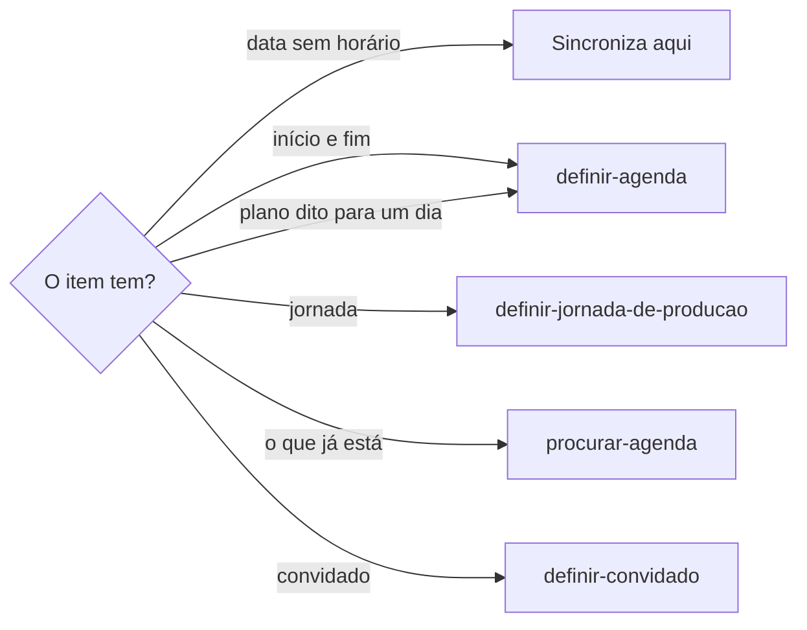
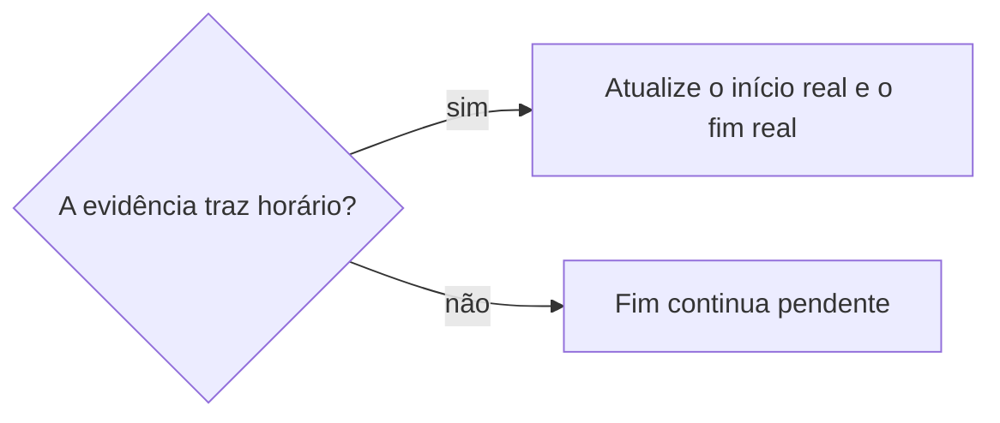
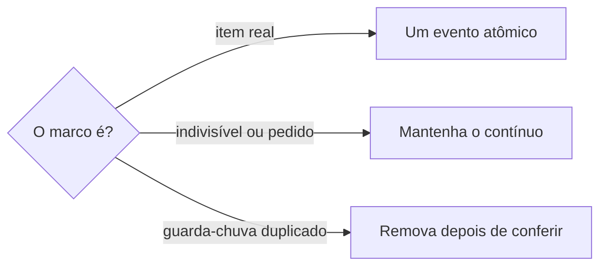

# Sincronizar cronograma

## Parâmetros de configuração

```yaml
{}
```

## Instruções

### Passo 1

As listas e o nome de cada propriedade vêm do mapeamento de dados do projeto. Sincronizar um item de viagem, missão, oportunidade ou o cronograma que tenha data e não tenha início e fim confirmados é esta habilidade. Cadastrar, revisar ou organizar a viagem canônica segue `definir-viagem`. O evento que já tem horário segue `definir-agenda`. O plano que a pessoa diz para um dia nomeado, como mala, cuidado ou saída, também segue `definir-agenda`. A jornada de produção segue `definir-jornada-de-producao`. Saber o que já está no dia segue `procurar-agenda`.



Quem entra como convidado segue `definir-convidado`.

### Passo 2

Não crie evento de dia inteiro só para o item aparecer na agenda. O item permanece no cronograma, pendente de horário, e fora da agenda, até existir evidência temporal suficiente. Dia inteiro só entra se a pessoa confirmar que o compromisso é de dia inteiro. Marcador sem horário não usa o formato de dia inteiro.

### Passo 3

Mensagem, foto, comprovante, localização, relato de quem participou ou outra evidência posterior que revele o horário atualiza o início real e o fim real. Não apague o planejamento original. Sem essas propriedades, pare. Não as crie.



### Passo 4

A viagem, missão, oportunidade ou programação com vários marcos no cronograma ganha um evento atômico para cada item real. Deslocamento, embarque, voo, visita, reunião, refeição, palestra, encerramento e outro compromisso distinto ficam separados. Cada evento aponta para um único item canônico do cronograma e usa o início, o fim, a localização, o contexto e a pessoa responsável ou participante daquele item. Momentos que a evidência revelar, como encontro, introdução, transfer, ambientação e happy hour, entram na mesma separação quando forem compromissos diferentes.



Não substitua vários marcos por um bloco diário nem por um evento de vários dias quando isso reduzir a encontrabilidade, esconder deslocamento, dificultar alteração ou criar convidado indevido. O evento contínuo ou de vários dias só permanece se for compromisso indivisível, tiver utilidade operacional independente ou for pedido explícito, sem duplicar os itens atômicos.

### Passo 5

Sem fim explícito, o início do próximo marco só vira término se a pessoa autorizou a regra «até o próximo marco». Essa autorização fica explícita na descrição ou na auditoria. Item sem horário de início, sem próximo marco ou no encerramento da programação permanece pendente até confirmação. Duração técnica só entra com autorização, e a suposição fica registrada. Sem isso, não invente a duração. Não crie um bloco excessivo.

### Passo 6

Horário real que substitui um marcador de dia inteiro já criado converte, atualiza ou remove o evento antigo. Se os eventos atômicos já cobrirem a programação, remova ou cancele bloco diário e evento guarda-chuva duplicado que não tenha função operacional própria. Antes de remover, confirme que os itens atômicos seguros foram criados e que nenhum dado exclusivo se perde. A gravação na agenda segue `definir-agenda`. Depois da sincronização, leia a agenda de novo. Se restar evento de dia inteiro usado só como marcador, converta, atualize ou remova.

## Problemas comuns

### Dia inteiro no lugar do horário

Se você criar um evento de dia inteiro porque o item só tem data, a agenda fica poluída com um marcador.

1. Deixe o item no cronograma, pendente de horário, e fora da agenda.
2. Dia inteiro só com a confirmação de que o compromisso é de dia inteiro.
3. Não use o formato de dia inteiro no lugar do horário ausente.

### Fim inventado

Se você usar o início do próximo marco como término sem autorização, ou inventar uma duração, o bloco nasce falso.

1. Sem autorização, o fim continua pendente.
2. Sem próximo marco e sem autorização para duração técnica, não crie bloco.
3. Não invente a duração.
4. Com autorização, deixe a regra explícita na descrição ou na auditoria, e registre a suposição da duração técnica.

### Guarda-chuva duplicado

Se você trocar vários marcos por um bloco diário ou um evento de vários dias, ou remover o guarda-chuva antes dos itens atômicos, a programação perde o que era encontrável ou um dado exclusivo.

1. Priorize um evento atômico para cada item real do cronograma.
2. Antes de remover o guarda-chuva, confirme os itens atômicos seguros e que nenhum dado exclusivo se perde.
3. Contínuo ou de vários dias só permanece se for indivisível, tiver utilidade própria ou for pedido explícito.

### Planejamento apagado

Se você apagar o planejamento original ao gravar o horário revelado, o que foi previsto some.

1. Atualize o início real e o fim real.
2. Preserve o planejamento original.
3. Sem essas propriedades, pare. Não as crie.

## Exemplos de entrada e saída

Estes exemplos ilustram fatos. Eles podem não estar no data source.

### sincronize essa missão. só tem a data.

O item ficou no cronograma, pendente de horário, e fora da agenda. Não criei evento de dia inteiro.

### a pessoa confirmou que esse compromisso é o dia inteiro

Criei o dia inteiro porque a pessoa confirmou. Não usei o formato para cobrir horário ausente.

### o comprovante mostra o horário do embarque

Atualizei o início real e o fim real. O planejamento original ficou. O embarque virou item atômico, separado do happy hour.

### use o próximo marco como fim

Não havia autorização. O fim continuou pendente. Não inventei a duração.

### Sincronize a viagem. o cronograma tem embarque, visita e palestra.

Cada marco virou um evento atômico, apontando para o item canônico, com o início, o fim, a localização, o contexto e a pessoa daquele item. Não juntei os três num bloco diário.

### pode usar até o próximo marco

A pessoa autorizou. O início do próximo item virou o fim operacional do anterior. A regra ficou explícita na descrição. O encerramento, sem próximo marco, continuou pendente.

### os atômicos já cobrem a programação

Removi o guarda-chuva duplicado depois de confirmar os itens atômicos e que nenhum dado exclusivo se perdia. O contínuo que era um compromisso indivisível ficou.

### esse dia inteiro era só marcador e agora tem horário

Converti o evento antigo. Li a agenda de novo. Não restou dia inteiro usado só como marcador.

## Casos-limite

- A data sem início e fim confirmados: não crie dia inteiro. O item fica no cronograma, pendente, e fora da agenda.
- A pessoa confirma que o compromisso é de dia inteiro: aí o dia inteiro pode entrar.
- Evidência posterior revela o horário: atualize o início real e o fim real. Preserve o planejamento. Sem as propriedades, pare. Não as crie.
- Vários marcos no cronograma: um evento atômico por item real, apontando para o item canônico. Não junte em bloco diário nem em evento de vários dias.
- Contínuo ou de vários dias: só se for indivisível, tiver utilidade operacional independente ou for pedido explícito, sem duplicar os atômicos.
- Antes de remover guarda-chuva: confirme os itens atômicos seguros e que nenhum dado exclusivo se perde.
- Dois momentos são compromissos diferentes: itens atômicos separados.
- Fim sem autorização para usar o próximo marco, ou sem próximo marco e sem duração técnica autorizada: fim pendente. Não invente.
- Horário real substitui dia inteiro já criado: converta, atualize ou remova, e leia a agenda de novo.
- O evento já tem início e fim: `definir-agenda`.
- A pessoa diz o plano de um dia nomeado: `definir-agenda`, mesmo sem hora.

## Pegadinhas

- Dia inteiro parece o jeito de fazer o item aparecer. Sem horário confirmado, ele fica fora da agenda.
- O início do próximo marco parece o fim natural. A regra «até o próximo marco» só vale com autorização, explícita na descrição ou na auditoria.
- Um bloco da viagem inteira parece mais simples. Vários marcos reais pedem um evento atômico cada. O guarda-chuva duplicado sai só depois que os atômicos seguros existem.
- Gravar o horário real parece apagar o plano. O início real e o fim real entram, e o planejamento original fica.
- Um happy hour no mesmo texto parece o mesmo item do embarque. Compromissos diferentes viram itens separados.

## Scripts disponíveis

- Nenhum.

1. Não há script para executar.
