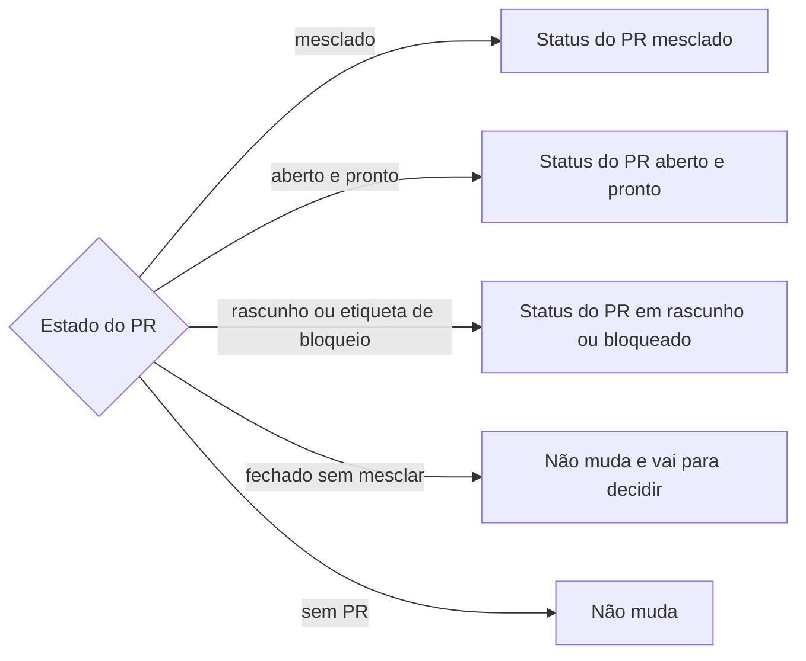

# Sincronizar status da tarefa

## Parâmetros de configuração

Leia cada valor nas instruções do projeto: primeiro na entrada com o nome desta habilidade, depois na entrada `Global` ou no primeiro nível do bloco, depois nas instruções de usuário. Quando um valor não estiver lá, use o padrão abaixo. Sem padrão e sem valor, pergunte uma vez e pare.

```yaml
"Consulta das tarefas": ""
"Fluxo de status": ""
"Status do PR mesclado": "concluído"
"Status do PR aberto e pronto": "em revisão"
"Status do PR em rascunho ou bloqueado": "em andamento"
"Etiquetas de PR bloqueado": ""
"Ligação entre tarefa e PR": "chave da tarefa no título, na branch ou no corpo do PR"
"Pedir confirmação do plano": "sim"
"Modo de aprendizado": "perguntar"
```

`Consulta das tarefas` é a busca que lista as tarefas da pessoa ainda abertas, na linguagem do rastreador do projeto. `Fluxo de status` é a lista ordenada dos status, do primeiro ao último, com o nome de cada transição entre eles. `Etiquetas de PR bloqueado` lista as etiquetas que mantêm a tarefa em andamento mesmo com o PR aberto e pronto.

## Instruções

### Passo 1

Obtenha as tarefas pela `Consulta das tarefas`, ou pela lista ou pelos links que a pessoa passou. Sem consulta e sem lista, pergunte e pare. Resultado grande que vem em arquivo é lido pelos campos chave, status e título, depois de conferir o formato do arquivo. Anote o status de cada tarefa como o rastreador devolveu.

### Passo 2

Ligue cada tarefa a um PR pela `Ligação entre tarefa e PR`. Busca pela chave traz PR que só cita a chave: abra o título e o corpo antes de ligar. Ligação feita só pelo assunto entra no plano marcada como "ligada pelo assunto".

Veja o estado de cada PR como no primeiro passo de `levantar-contexto-do-pull-request`: aberto, mesclado ou fechado, rascunho ou pronto, etiquetas.



Não mude a tarefa quando o PR cita outra chave, quando o PR foi fechado sem mesclar ou quando o destino depende de julgamento, como tarefa-mãe com filhas, atualização de versão ou PR ligado só pelo assunto sem confirmação. Liste essas tarefas com o motivo, para a pessoa decidir.

### Passo 3

Grave o plano: para cada tarefa, o status atual lido, o PR, o estado do PR, o status de destino e os passos do `Fluxo de status` entre os dois. Antes de executar, releia o estado do PR e da tarefa. Se algo mudou, corrija o plano. Com `Pedir confirmação do plano` em `sim`, mostre o plano e espere a resposta. Com `não`, siga.

### Passo 4

Execute uma tarefa por vez, um passo do fluxo por vez. Não existe atalho: se o destino não é o próximo status, passe por cada um no meio. Depois de cada transição, leia o status que o retorno trouxe, e só então dê o próximo passo na mesma tarefa. Se o nome da transição não existir, a mensagem de erro lista as que existem: use essa lista para saber onde a tarefa está.

Chamada negada ou com erro para a execução daquela tarefa. Anote "não feito" e o status em que ela ficou, lido do último retorno que deu certo. Não repita a chamada, não contorne por outra ferramenta e siga com as outras tarefas. Só repita com o ok da pessoa, depois de reler o status.

### Passo 5

Antes de relatar, releia o status das tarefas que tiveram negação ou erro. Conte a lista final, uma tarefa por vez. A soma das partes bate com o total.

Relate em blocos: um por status final, com a chave, o link da tarefa e o link do PR, montados do status que o retorno trouxe. Depois, as "não feitas", com o motivo e o status real. Depois, as "não mexi", com o motivo. Diga as ligações feitas só pelo assunto. Se um relato anterior desta conversa trouxe estado ou número errado, a primeira frase corrige: o que foi dito e o que é o certo.

### Passo 6

Ao terminar, siga `evoluir-habilidade` conforme `Modo de aprendizado`.

## Problemas comuns

### Relato do destino no lugar do status lido

Se você disser que a tarefa está no status de destino porque era o plano, o relato esconde o item que parou no meio.

1. Releia o status de cada tarefa com negação ou erro.
2. Relate o status que a ferramenta devolveu.
3. Anote "não feito" para o que não chegou ao destino.

### Total de memória

Se você escrever o total ou o número por status sem contar a lista, a soma das partes não bate.

1. Monte a lista final, uma tarefa por linha.
2. Conte por status.
3. Confira que a soma é o total antes de enviar.

### Repetição de chamada negada

Se você repetir a chamada que foi negada ou contornar por outra ferramenta, a ação passa por cima da decisão de quem negou.

1. Pare naquela tarefa.
2. Termine as outras e relate o motivo.
3. Repita só com o ok da pessoa, depois de reler o status.

### Pulo de etapa

Se você tentar levar a tarefa direto ao destino, a transição não existe e a mensagem de erro lista só as que valem para o status atual.

1. Siga o `Fluxo de status` um passo por vez.
2. Leia o status devolvido antes do próximo passo.
3. Use a lista da mensagem de erro para saber o status atual.

### PR que só cita a chave

Se você ligar a tarefa ao PR só porque a busca achou a chave, o status muda por um PR de outra tarefa.

1. Abra o título e o corpo do PR.
2. Ligue só quando o PR é da tarefa.
3. Quando só o assunto bate, marque "ligada pelo assunto".

## Exemplos de entrada e saída

Estes exemplos ilustram fatos. Eles podem não estar no data source.

### Atualizar as tarefas abertas pelos PRs, com o fluxo "a fazer, em andamento, em revisão, concluído"

A habilidade lista três tarefas abertas. "Exportar relatório em CSV" tem o PR 12 mesclado e está em "a fazer". "Validar o formulário de contato" tem o PR 15 aberto e pronto, em "em andamento". "Ordenar a lista de pedidos" não tem PR. O plano leva a primeira até "concluído", passando por cada status, leva a segunda a "em revisão" e deixa a terceira como está.

### Uma transição é negada no meio

A habilidade leva "Exportar relatório em CSV" de "a fazer" a "concluído". A segunda transição é negada. O relato diz que a tarefa ficou em "em andamento", que o destino era "concluído" e que ela está na lista das não feitas, com o motivo.

## Casos-limite

- O PR está aberto e pronto, mas tem uma etiqueta de `Etiquetas de PR bloqueado`: o destino é o `Status do PR em rascunho ou bloqueado`.
- O PR foi fechado sem mesclar: a tarefa não muda e vai para a lista de decisão.
- A tarefa já está no status de destino: não muda e aparece nas "não mexi".
- A tarefa tem mais de um PR: use o mais recente e diga qual usou. Se um está aberto e o outro mesclado, a tarefa vai para decidir.
- O rastreador não aceita o nome da transição: leia a lista da mensagem de erro e use o nome que ela mostra.
- Nenhum `Fluxo de status` nas instruções: pergunte uma vez e pare.

## Pegadinhas

- A negação pode ter vindo de uma transição do meio. O status real fica antes do que parece, então releia antes de repetir.
- O resultado de uma busca grande pode vir em arquivo, às vezes como lista direta sem objeto em volta. Confira o formato antes de filtrar.
- Uma transição devolve a tarefa inteira. O status novo está no campo de status desse retorno.
- A tarefa fica em "em andamento" quando o PR está em rascunho, mesmo que ele esteja aberto.

## Scripts disponíveis

- Nenhum.

1. Não há script para executar.
