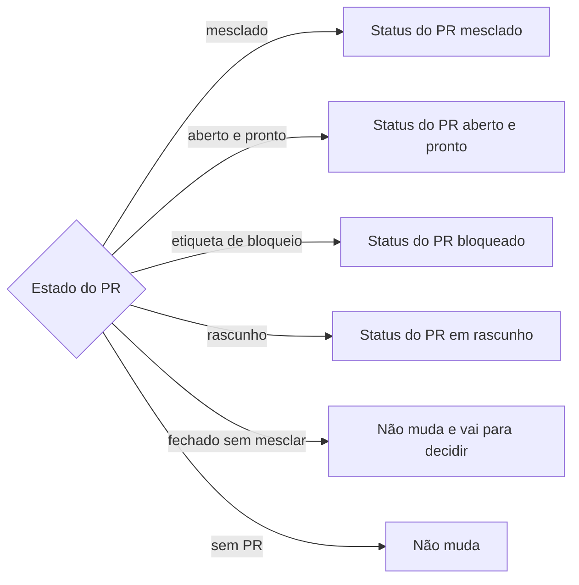
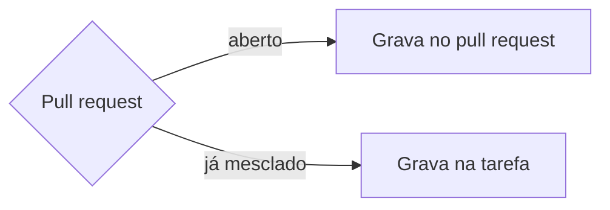
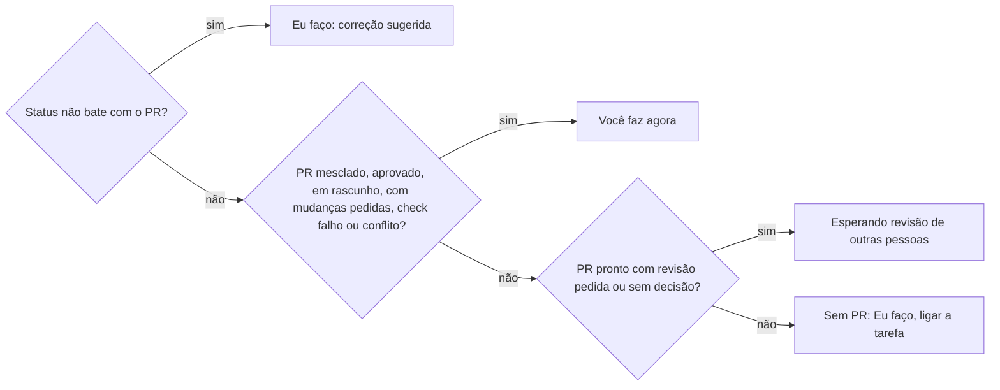

# Sincronizar status da tarefa

## Parâmetros de configuração

Leia cada valor nas instruções do projeto: primeiro na entrada com o nome desta habilidade, depois na entrada `Global` ou no primeiro nível do bloco, depois nas instruções de usuário. Quando um valor não estiver lá, use o padrão abaixo. Sem padrão e sem valor, pergunte uma vez e pare.
```yaml
# `Consulta das tarefas` é a busca que lista as tarefas da pessoa ainda abertas, na linguagem do rastreador do projeto.
"Consulta das tarefas": ""
# `Consulta do panorama` é a busca que lista as tarefas que a pessoa criou, abertas e fechadas, com o PR ligado a cada uma, na linguagem do rastreador do projeto. `Consulta do panorama` vazia pergunta uma vez e para.
"Consulta do panorama": ""
# `Fluxo de status` é a lista ordenada dos status, do primeiro ao último, com o nome de cada transição entre eles. `Fluxo de status` vazio não muda o status e não interrompe a gravação da ligação.
"Fluxo de status": ""
"Status do PR mesclado": "concluído"
"Status do PR aberto e pronto": "em revisão"
"Status do PR em rascunho": "em andamento"
# Com `Status do PR bloqueado` em `não muda`, a tarefa fica onde está e entra na lista para decidir.
"Status do PR bloqueado": "não muda"
# `Etiquetas de PR bloqueado` lista as etiquetas que marcam o PR como bloqueado, esteja ele em rascunho ou pronto. Rascunho é o estado do PR. Bloqueio é um sinal à parte, dado pelas etiquetas, e tem precedência sobre o rascunho.
"Etiquetas de PR bloqueado": ""
# `Status do panorama` é o status das tarefas do panorama por status, quando a pessoa não diz outro.
"Status do panorama": "em revisão"
"Ligação entre tarefa e PR": "chave da tarefa no título, na branch ou no corpo do PR"
# `Registro da ligação` diz como gravar a ligação entre a tarefa e o pull request, no pull request ainda aberto e no pull request já mesclado. `Registro da ligação` vazio pergunta uma vez e para, sem gravar.
"Registro da ligação": ""
"Pedir confirmação do plano": "sim"
"Modo de aprendizado": "perguntar"
```
## Instruções

### Passo 1

Obtenha as tarefas pela `Consulta das tarefas`, ou pela lista ou pelos links que a pessoa passou.
Quando a habilidade roda por um commit ou por uma mudança de pull request, parta desse pull request e busque as tarefas abertas.
Toda mudança de estado de um pull request que o turno faz, ou que a pessoa ou o aplicativo avisam, roda esta habilidade na mesma resposta, antes de responder.
Isso vale também quando o PR foi aberto, tirado do rascunho ou mesclado pelo `gh` direto, sem passar por `criar-pull-request` nem por `mesclar-pull-request`.
Quando a pessoa pede o panorama, obtenha as tarefas pela `Consulta do panorama`, que traz as abertas e as fechadas do que ela criou.
Se o pedido não diz de quem, pergunte uma vez se o panorama é só do que a pessoa criou ou de todas as abertas.
Para todas as abertas, use a mesma consulta sem o filtro da pessoa e só com as abertas.
O panorama só lê: ligue cada tarefa ao PR pelo Passo 2, relate pelo Passo 5 e pule o plano, a gravação da ligação e a mudança de status.
Quando a pessoa pede o panorama de um status, como "o que está em revisão", filtre as tarefas dela pelo status pedido, ou pelo `Status do panorama`, e relate pelo Passo 5 em três blocos.
Para tarefas de qualquer status misturadas, parta da `Consulta do panorama` sem filtro de status.
Sem consulta e sem lista, pergunte e pare. Resultado grande que vem em arquivo é lido pelos campos chave, status e título, depois de conferir o formato do arquivo. Anote o status de cada tarefa como o rastreador devolveu.

### Passo 2

Ligue cada tarefa a um PR pela `Ligação entre tarefa e PR`.
Busca pela chave traz PR que só cita a chave: abra o título e o corpo antes de ligar.
Partindo do pull request, compare o assunto dele com o título de cada tarefa aberta.
Ligação feita só pelo assunto entra no plano marcada como "ligada pelo assunto".

Veja o estado de cada PR como no primeiro passo de `levantar-contexto-do-pull-request`: aberto, mesclado ou fechado, rascunho ou pronto, e as etiquetas.



Não mude o status da tarefa quando o PR cita outra chave, quando o PR foi fechado sem mesclar ou quando o destino depende de julgamento, como tarefa-mãe com filhas, atualização de versão ou PR ligado só pelo assunto sem confirmação.
Liste essas tarefas com o motivo, para a pessoa decidir.
A ligação pelo assunto espera a confirmação do plano.
Com o sim, grave a ligação como `Registro da ligação` manda, no momento que combina com o estado do pull request.
No pull request ainda aberto, a gravação entra nele.
No pull request já mesclado, a gravação entra na tarefa, com o link do pull request.
Leia antes os comentários da tarefa: se já existe um seu sobre o mesmo assunto, edite esse comentário em vez de abrir outro.
Uma citação acrescentada depois do merge não fecha a tarefa.
Percorrer as tarefas abertas e fechá-las não é desta habilidade.
A tarefa fecha quando o pull request que a cita, ainda aberto, é mesclado, e o critério de pronto dela está cumprido.



### Passo 3

Grave o plano: para cada tarefa, o status atual lido, o PR, o estado do PR, se a ligação será gravada, o status de destino e os passos do `Fluxo de status` entre os dois.
Sem `Fluxo de status`, o status de destino fica como está. Antes de executar, releia o estado do PR e da tarefa. Se algo mudou, corrija o plano. Com `Pedir confirmação do plano` em `sim`, mostre o plano e espere a resposta. Com `não`, siga.

### Passo 4

Com `Fluxo de status`, execute uma tarefa por vez, um passo do fluxo por vez.
Sem `Fluxo de status`, não mude o status.
Depois do sim do plano, grave a ligação da tarefa marcada para gravar. Não existe atalho: se o destino não é o próximo status, passe por cada um no meio. Depois de cada transição, leia o status que o retorno trouxe, e só então dê o próximo passo na mesma tarefa. Se o nome da transição não existir, a mensagem de erro lista as que existem: use essa lista para saber onde a tarefa está.

Chamada negada ou com erro para a execução daquela tarefa. Anote "não feito" e o status em que ela ficou, lido do último retorno que deu certo. Não repita a chamada, não contorne por outra ferramenta e siga com as outras tarefas. Só repita com o ok da pessoa, depois de reler o status.

### Passo 5

Antes de relatar, releia o status das tarefas que tiveram negação ou erro. Conte a lista final, uma tarefa por vez. A soma das partes bate com o total.

Relate em blocos: um por status final, com a chave, o link da tarefa e o link do PR, montados do status que o retorno trouxe. Depois, as "não feitas", com o motivo e o status real. Depois, as "não mexi", com o motivo. Diga as ligações feitas só pelo assunto.
No panorama, os blocos são: aberta com PR aberto, aberta com PR mesclado, aberta sem PR e fechada.
No panorama por status, leia de cada PR o estado, o rascunho, a decisão de revisão, as revisões pedidas, os checks e os conflitos, e some uma linha por tarefa a um destes três blocos, pela primeira pergunta que bater.



`Você faz agora` leva o que só a pessoa destrava: mesclar o aprovado, responder mudanças pedidas, consertar check ou conflito, terminar o rascunho.
`Esperando revisão de outras pessoas` leva o PR pronto que aguarda quem revisa, com os nomes pedidos.
`Eu faço` leva o que a habilidade faz depois do sim: gravar a ligação e corrigir o status.
O status que não bate vira correção sugerida, com o status lido, o status que o PR indica e o motivo. Por exemplo, tarefa concluída com PR ainda aberto, ou em revisão com PR mesclado.
Nenhuma correção se aplica sem a confirmação da pessoa. Com o sim, siga os Passos 3 e 4.
Cada bloco é uma tabela com o link da tarefa, o título curto, o link do PR e uma frase com o motivo.
O relato abre com um placar, uma linha por bloco com a contagem, e segue com uma tabela por bloco, com o link, o título curto, o link do PR e as etiquetas de cada tarefa.
Número sem título não se reconhece: nunca liste só os números.
Se um relato anterior desta conversa trouxe estado ou número errado, a primeira frase corrige: o que foi dito e o que é o certo.

### Passo 6

Ao terminar, siga `evoluir-habilidade` conforme `Modo de aprendizado`.

## Problemas comuns

### Relato do destino no lugar do status lido

Se você disser que a tarefa está no status de destino porque era o plano, o relato esconde o item que parou no meio.

1. Releia o status de cada tarefa com negação ou erro.
2. Relate o status que a ferramenta devolveu.
3. Anote "não feito" para o que não chegou ao destino.

### Total de memória

Se você escrever o total ou o número por status sem contar a lista, a soma das partes não bate.

1. Monte a lista final, uma tarefa por linha.
2. Conte por status.
3. Confira que a soma é o total antes de enviar.

### Repetição de chamada negada

Se você repetir a chamada que foi negada ou contornar por outra ferramenta, a ação passa por cima da decisão de quem negou.

1. Pare naquela tarefa.
2. Termine as outras e relate o motivo.
3. Repita só com o ok da pessoa, depois de reler o status.

### Pulo de etapa

Se você tentar levar a tarefa direto ao destino, a transição não existe e a mensagem de erro lista só as que valem para o status atual.

1. Siga o `Fluxo de status` um passo por vez.
2. Leia o status devolvido antes do próximo passo.
3. Use a lista da mensagem de erro para saber o status atual.

### Estado do PR mudou e a tarefa ficou parada

Se você abrir, tirar do rascunho ou mesclar o PR pelo `gh` direto, ou ler que a pessoa mesclou, e seguir sem rodar esta habilidade, o status da tarefa fica para trás e o progresso do card sai errado.

1. Rode esta habilidade na mesma resposta em que o estado do PR mudou ou foi avisado.
2. Não espere a pessoa pedir.
3. Releia o status de cada tarefa ligada ao stack de PRs da conversa, não só o do PR do momento.

### Comentário a mais na tarefa

Se você abrir um comentário novo para o que já está num comentário seu na tarefa, a pessoa lê duas versões do mesmo registro, e a ferramenta não apaga comentário.

1. Leia os comentários da tarefa antes de gravar.
2. Se já há um seu sobre o mesmo assunto, edite esse com o texto completo, e não acrescente outro.
3. Se sobrar um duplicado, diga qual é e peça para a pessoa apagá-lo.

### PR que só cita a chave

Se você ligar a tarefa ao PR só porque a busca achou a chave, o status muda por um PR de outra tarefa.

1. Abra o título e o corpo do PR.
2. Ligue só quando o PR é da tarefa.
3. Quando só o assunto bate, marque "ligada pelo assunto" e espere a confirmação do plano antes de gravar a ligação.

## Exemplos de entrada e saída

Estes exemplos ilustram fatos. Eles podem não estar no data source.

### Atualizar as tarefas abertas pelos PRs, com o fluxo "a fazer, em andamento, em revisão, concluído"

A habilidade lista três tarefas abertas. "Exportar relatório em CSV" tem o PR 12 mesclado e está em "a fazer". "Validar o formulário de contato" tem o PR 15 aberto e pronto, em "em andamento". "Ordenar a lista de pedidos" não tem PR. O plano leva a primeira até "concluído", passando por cada status, leva a segunda a "em revisão" e deixa a terceira como está.

### Uma transição é negada no meio

A habilidade leva "Exportar relatório em CSV" de "a fazer" a "concluído". A segunda transição é negada. O relato diz que a tarefa ficou em "em andamento", que o destino era "concluído" e que ela está na lista das não feitas, com o motivo.

### o pull request da entrega não cita a tarefa

A entrega "Publicar o relatório" está num pull request aberto, sem a chave da tarefa. A busca das tarefas abertas acha "Publicar o relatório em CSV". O plano marca "ligada pelo assunto" e espera o sim. Com o sim, a habilidade grava `Closes #<número>` no corpo do pull request.

### o pull request já foi mesclado e o projeto não tem fluxo de status

A mesma entrega está num pull request já mesclado. O plano marca "ligada pelo assunto" e espera o sim. Com o sim, a habilidade comenta na tarefa com o link do pull request. O status fica como está.

### o panorama do que a pessoa criou

A pessoa pede o panorama do que criou. A consulta traz quatro tarefas. "Exportar relatório em CSV" está aberta e tem o PR 12 em rascunho. "Validar o formulário de contato" está aberta e o PR 15 já foi mesclado. "Ordenar a lista de pedidos" está aberta e não tem PR. "Corrigir o rodapé" está fechada. O relato abre com o placar, com uma tarefa em cada bloco, e traz uma tabela por situação, com o link, o título e o link do PR de cada tarefa, sem mudar nenhum status.

### o panorama das tarefas em revisão

A pessoa pede o que está em revisão. Quatro tarefas: ABC-1 tem o PR aprovado e aberto, ABC-2 tem o PR pronto aguardando revisão, ABC-3 está concluída e o PR segue aberto, ABC-4 tem o PR em rascunho. ABC-1 e ABC-4 vão em `Você faz agora`, ABC-2 em `Esperando revisão de outras pessoas`, e ABC-3 em `Eu faço`, como correção sugerida de concluída para em revisão, sem aplicar.

## Casos-limite

- No panorama por status, a tarefa com mais de um PR segue o caso do PR mais recente, e a pessoa vê qual foi usado.
- No panorama por status, o PR cujo checks ainda rodam fica em `Esperando revisão de outras pessoas` com a nota de que o resultado não saiu.

- No panorama, a tarefa aberta cujo PR já foi mesclado vai no bloco próprio e continua aberta, como acontece quando o PR a cita sem palavra de fechamento. Quem a fecha é o merge do PR que a cita com essa palavra, ou a pessoa, não esta habilidade.
- O PR está aberto e pronto, mas tem uma etiqueta de `Etiquetas de PR bloqueado`: o destino é o `Status do PR bloqueado`, não o de aberto e pronto.
- O PR está em rascunho e tem etiqueta de bloqueio: vale o `Status do PR bloqueado`.
- O PR foi fechado sem mesclar: a tarefa não muda e vai para a lista de decisão.
- A tarefa já está no status de destino: não muda e aparece nas "não mexi".
- A tarefa tem mais de um PR: use o mais recente e diga qual usou. Se um está aberto e o outro mesclado, a tarefa vai para decidir.
- O rastreador não aceita o nome da transição: leia a lista da mensagem de erro e use o nome que ela mostra.
- Nenhum `Fluxo de status` nas instruções: grave a ligação confirmada e não mude o status. Sem `Registro da ligação`, pergunte uma vez e pare.

## Pegadinhas

- A negação pode ter vindo de uma transição do meio. O status real fica antes do que parece, então releia antes de repetir.
- O resultado de uma busca grande pode vir em arquivo, às vezes como lista direta sem objeto em volta. Confira o formato antes de filtrar.
- Uma transição devolve a tarefa inteira. O status novo está no campo de status desse retorno.
- A tarefa fica em "em andamento" quando o PR está em rascunho, mesmo que ele esteja aberto.
- A habilidade parece servir só quando a pessoa pede a varredura. Ela também roda depois de um commit ou de uma mudança no estado do pull request.
- O lugar das tarefas parece fixo. Ele muda de um negócio para outro e fica em `Consulta das tarefas`.
- A busca pela chave parece achar o pull request feito sem citar a tarefa. Parta desse pull request e compare o assunto com as tarefas abertas.
- Uma citação no pull request já mesclado, ou uma varredura das tarefas abertas, parece fechar a tarefa. A gravação entra na tarefa, com o link do pull request. A tarefa fecha quando o pull request que a cita, ainda aberto, é mesclado, e o critério de pronto dela está cumprido.
- Uma frase comprimida parece um recado interno. A skill fica fácil de ler por uma pessoa.
- Abrir, tirar do rascunho ou mesclar o PR pelo `gh` parece não ter relação com a tarefa. O estado do PR mudou, e a habilidade roda mesmo assim.
- O aviso de que um PR foi mesclado parece só uma informação. É gatilho: confirme o estado MERGED e sincronize a tarefa na mesma resposta.
- A `Consulta do panorama` pode listar só o PR que fecha a tarefa. A tarefa que parece sem PR pode ter um que só cita a chave, então busque pela chave antes de dizer que não tem.
- A busca pela chave, num rastreador em que tarefa e PR compartilham a numeração, como o GitHub, casa o número como texto em qualquer PR, inclusive nos antigos, e o número escrito pode não ser o da tarefa.
  Abra o corpo de cada resultado e ligue só o que cita a tarefa.
  Um PR de número menor também pode citá-la, quando foi aberto antes da tarefa e teve o corpo editado depois.
  Veja se o PR resolve a tarefa ou só a menciona, como num "fora do escopo" ou num acompanhamento.
- A consulta do rastreador pode limitar o resultado por padrão, como o `gh issue list`, que traz 30.
  Ponha o limite na consulta gravada e confira que o total bate com o do rastreador, senão o panorama sai incompleto sem aviso.

## Scripts disponíveis

- Nenhum.

1. Não há script para executar.
