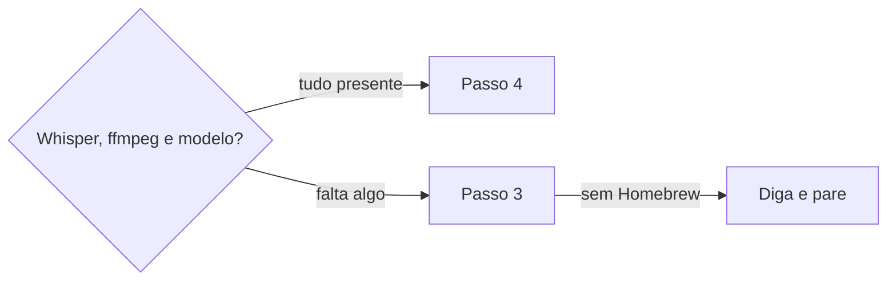

# Transcrever áudio e vídeo

## Parâmetros de configuração

```yaml
# `Pasta do modelo` é a pasta dos arquivos de modelo do Whisper.
"Pasta do modelo": "~/.local/share/whisper.cpp/models"
# `Modelo` é o arquivo do modelo dentro da `Pasta do modelo`. O padrão é o large-v3-turbo quantizado, de 547 MB.
"Modelo": "ggml-large-v3-turbo-q5_0.bin"
# `Idioma da transcrição` é o código do idioma falado, como `pt` ou `en`.
"Idioma da transcrição": "pt"
# `Termos do prompt` lista nomes e termos que o áudio cita e que o Whisper costuma errar. Vazio, a transcrição roda sem prompt.
"Termos do prompt": []
# `Pasta de saída` guarda o áudio extraído e a transcrição. Vazio, é uma pasta de trabalho temporária da sessão.
"Pasta de saída": ""
"Modo de aprendizado": "perguntar"
```

## Instruções

### Passo 1

Receba o caminho do arquivo de áudio ou vídeo e confirme que ele existe.
A transcrição roda na máquina da pessoa, com terminal. Sessão sem terminal e sem acesso aos arquivos locais, como o Notion, não roda esta skill: pare e diga que a transcrição roda numa ferramenta de código com o arquivo na máquina.
Não envie o arquivo a um serviço externo.

### Passo 2



Detecte o ambiente com os comandos de Scripts disponíveis: `whisper-cli`, `ffmpeg` e o arquivo do `Modelo` na `Pasta do modelo`.

### Passo 3

Diga o que falta e o que a instalação baixa: o programa e o `ffmpeg`, pelo Homebrew, e o modelo, do repositório oficial do `whisper.cpp`, com o tamanho dele. Diga que é gratuito, roda na máquina e não pede conta. Espere o sim da pessoa antes de instalar ou baixar qualquer coisa.
Sem Homebrew, diga isso e pare. Não troque por um serviço externo sem a pessoa pedir.

### Passo 4

Extraia o áudio para wav de 16 kHz e mono, na `Pasta de saída`. Nunca grave ao lado do original nem sobre ele. O vídeo fica como está.
Ponha o caminho do arquivo entre aspas: nome com espaço e acento é comum.

### Passo 5

Rode o `whisper-cli` com o `Idioma da transcrição`, `-ml 0` e as saídas `.txt` e `.srt`. Com `Termos do prompt` preenchido, passe-os em `--prompt`.
Num Apple M4 Pro, o tempo é cerca de um dezoito avos da duração do áudio. Leia `references/tempos-medidos.md` quando for avisar o tempo de um arquivo longo ou de um lote. Em outra máquina o tempo muda: avise a pessoa antes e espere o resultado no mesmo turno.
Com mais de uma gravação, rode o script de lote: ele é retomável, roda uma instância só, começa pelas mais curtas e registra a falha de cada gravação sem parar as outras. Diga o tempo estimado do lote antes de começar.

### Passo 6

Leia o texto antes de relatar. Entregue o caminho do `.txt`, que é o texto corrido, e do `.srt`, que traz os tempos.
Diga três coisas: o texto não diz quem fala, nomes próprios e termos do time podem sair errados, e um trecho confuso fica sem uso em ata ou registro até a pessoa ouvir.
Um termo que errou e volta a aparecer é candidato a `Termos do prompt`: sugira, sem gravar.
Apague o wav intermediário. Se a transcrição vira registro de reunião, siga `definir-registro-de-reuniao`.

### Passo 7

Ao terminar, siga `evoluir-habilidade` conforme `Modo de aprendizado`.

## Problemas comuns

### Instalar sem o sim

Se você instalar o programa ou baixar o modelo antes de a pessoa dizer sim, a máquina ganha arquivos que ela não pediu.

1. Diga o que falta, o tamanho do modelo e que é gratuito.
2. Espere o sim.
3. Só então instale.

### Serviço externo no lugar do Whisper

Se você enviar o áudio a um serviço de transcrição quando o Whisper local falta, a gravação sai da máquina sem a pessoa saber.

1. Proponha a instalação local, como no Passo 3.
2. Serviço externo só entra se a pessoa pedir, e a resposta avisa que o arquivo sai da máquina.

### Texto picado

Se você rodar sem `-ml 0`, o texto sai com uma linha curta por trecho e fica difícil de ler.

1. Rode com `-ml 0`.
2. Releia o resultado antes de entregar.

### Transcrição tratada como ata

Se você usar o texto direto como registro ou ata, falas ficam sem autor e nomes errados entram como fato.

1. Diga que o texto não identifica quem fala.
2. Aponte nome e termo suspeito.
3. Siga `definir-registro-de-reuniao` só depois de a pessoa confirmar o que está claro.

## Exemplos de entrada e saída

Estes exemplos ilustram fatos. Eles podem não estar no data source.

### Transcreva esta gravação de uma daily: um vídeo de 20 minutos na área de trabalho.

Detectei `whisper-cli`, `ffmpeg` e o modelo. Extraí o áudio para wav e transcrevi em português, com `-ml 0` e `.txt` e `.srt`. Entreguei os dois caminhos e avisei que o texto não diz quem fala e que alguns nomes podiam estar errados. Apaguei o wav.

### Transcreva este áudio, e a máquina não tem o Whisper.

Disse que faltavam o `whisper-cli`, o `ffmpeg` e o modelo de 547 MB, que a instalação é gratuita e local, e esperei o sim antes de instalar. Não enviei o arquivo a um serviço externo.

## Casos-limite

- O arquivo já é áudio, como mp3 ou m4a: o `ffmpeg` converte do mesmo jeito para wav de 16 kHz e mono.
- O áudio está em outro idioma: troque `Idioma da transcrição` para a execução.
- O modelo escolhido não é o padrão: o tamanho vem do repositório do modelo. Diga que não mediu a qualidade nem o tempo dele.
- A reunião já tem transcrição pronta, como a do Meet: use essa, que traz quem fala. Esta skill não é para ela.
- A pessoa pede um serviço externo: só com pedido explícito, avisando que o arquivo sai da máquina.
- O arquivo não existe ou não abre: diga o caminho que tentou e pare.

## Pegadinhas

- A fórmula `whisper-cpp` do Homebrew instala o `whisper-cli`, mas não baixa modelo nenhum.
- O prompt ajuda em parte. No teste, ele corrigiu alguns termos e deixou outros errados, e puxou um termo do prompt para mais lugares do que o áudio dizia. Releia os termos do prompt no resultado.
- O `.txt` não tem tempo. Quem precisa do minuto de uma fala usa o `.srt`.
- Nome de arquivo com espaço e acento quebra o comando sem aspas.
- O número de tempo vem de uma medição, numa máquina. Não prometa o mesmo tempo em outra.
- O `ffmpeg` lê o teclado por padrão. Num laço de shell ele consome as linhas da fila e corta os caminhos: use `-nostdin`, ou o script de lote.

## Scripts disponíveis

- `command -v whisper-cli ffmpeg` mostra o que está instalado.
- `ls "<Pasta do modelo>/<Modelo>"` confere o modelo.
- `brew install whisper-cpp ffmpeg` instala o programa e o `ffmpeg`.
- `curl -L -o "<Pasta do modelo>/<Modelo>" "https://huggingface.co/ggerganov/whisper.cpp/resolve/main/<Modelo>"` baixa o modelo.
- `ffmpeg -nostdin -loglevel error -y -i "<arquivo>" -vn -ar 16000 -ac 1 "<Pasta de saída>/audio.wav"` extrai o áudio.
- `whisper-cli -m "<Pasta do modelo>/<Modelo>" -l <Idioma da transcrição> -ml 0 --prompt "<Termos do prompt>" -otxt -osrt -of "<Pasta de saída>/transcricao" -f "<Pasta de saída>/audio.wav"` transcreve.

- `python3 -I scripts/transcribe_batch.py --queue "<arquivo com um caminho por linha>" --out "<Pasta de saída>"` transcreve várias gravações. `--state "<arquivo>"` grava o progresso em JSON e `--dry-run` só conta o que falta.

1. Detecte, instale só com o sim, extraia o áudio e transcreva, nessa ordem. Com várias gravações, use o script de lote no lugar da extração e da transcrição.
