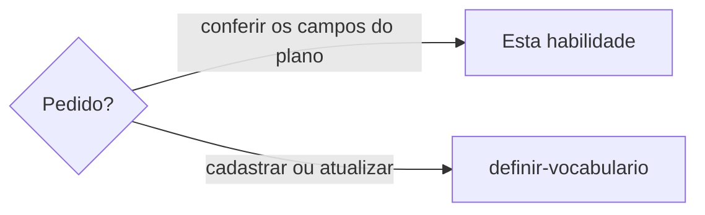

# Validar plano de vocabulário

## Parâmetros de configuração

Quando `definir-vocabulario` chama esta habilidade, vale o que ela passa.

```yaml
"Categorias": {}
"Validação dos campos": "warn"
"Domínio do e-mail de quem decide": ""
```

## Instruções

### Passo 1

`definir-vocabulario` monta o plano, `classificar-estado-do-termo` decide o nível de cada termo, e esta habilidade confere os campos antes da escrita. Esta habilidade só valida. Ela não grava, e a escrita segue `gravar-termos-no-vocabulario`.



### Passo 2

Valide o plano antes de gravar.

- `categories` são palavras em inglês, em qualquer idioma, como `punctuation`. Categoria no idioma do projeto vira a palavra que `Categorias` mapeia. Sem mapa, pergunte. Categoria não vira tag: a tag esconde o termo da consulta de outro contexto. Termo, descrição e notas ficam no idioma do vocabulário.
- `reason` só nos níveis de uso e diz por que usamos. `description` explica a palavra, e o motivo de evitar fica nela. Não copie um no outro.
- `forbidden` e `strongly_discouraged` recusam `examples`. O exemplo ruim vai em `rejected`.
- Campo esperado que a pessoa não deu, como `reason`: monte o texto com o que ela enviou (a mensagem, o antes e depois, a nota) e diga que a redação é sua, para ela ajustar. Só fica de fora o que não tem base nenhuma: diga quais e pergunte. Passe `Validação dos campos` em `validation`.
- Quem decidiu vai em `decided_by`, como os campos de pessoa do `package.json`: `name`, `email` e, se houver, `url`. O e-mail é o individual da pessoa no workspace, nunca o de uma conta de função compartilhada. Com `Domínio do e-mail de quem decide` preenchido, o e-mail termina nesse domínio. Sem o e-mail, pergunte. Se a pessoa só tem um e-mail que divide com outra, grave só o `name` e complete o `email` quando ela tiver um individual. O endereço da linha de origem vai em `source`.
- Todo termo do lote leva `decided_by` e `decided_at`, em qualquer nível, permitido ou proibido. `decided_at` é o dia da decisão em ISO 8601, `AAAA-MM-DD`.
- `source` é o trecho ou a página de onde o termo saiu, só como registro de origem. Vários termos da mesma mensagem ou página levam a mesma `source`, no mesmo lote e em chamadas diferentes. Ela não liga uma linha à outra. A conversa em que a decisão foi tomada vai em `notes`.
- `notes` guarda o histórico que nenhum campo guarda: um link ou o limite que `description` e `when` não dizem. Não repita nele quem decidiu nem a data. `description` só diz o que o termo é. O registro formal ou informal vai em `categories`, não em campo. Não muda o estado.
- Um termo não é o próprio exemplo. A mesma grafia não entra duas vezes.
- `term`, `examples`, `rejected` e `alternatives` nunca levam link real. No lugar do link, escreva um marcador entre colchetes, como `[link da tarefa]`. O endereço da página de origem fica em `source`. A escrita recusa o termo com `http://` ou `https://` nesses campos.
- `state` é a permissão. `description` não repete o estado. Só a stop word, com `stop_word: true`, pode vir sem `state`.
- Exemplo de contexto e exemplo mais longo ficam em `examples`. Termo já cadastrado fica em `related`.
- Documentação complementar só quando a pessoa pedir.
- Validação falha: corrija e valide de novo. Não grave.

## Problemas comuns

### Categoria no idioma do texto

Se você gravar a categoria no idioma do vocabulário, a palavra do texto entra no lugar da categoria em inglês.

1. Reescreva a categoria em inglês, em minúsculas.
2. Mantenha o termo e a descrição no idioma do vocabulário.
3. Valide de novo antes de gravar.

### Descrição no lugar do motivo

Se você repetir em `description` por que usamos, a explicação da palavra some.

1. `description` explica a palavra.
2. Em `allowed`, `reason` diz por que usamos.
3. Não copie um no outro.

### Nome ou data no texto do termo

Se você escrever quem decidiu ou a data em `description`, `reason` ou `source`, a consulta perde o campo e o texto do termo envelhece.

1. Quem decidiu vai em `decided_by` e o dia em `decided_at`, em todo termo do lote.
2. Link e conversa vão em `notes`, sem repetir o nome nem a data.
3. `description` diz o que o termo é, e `reason` diz por que usamos.

### Termo inventado

Se você completar descrição ou exemplo que a pessoa não deu, o vocabulário ganha uma frase que ela não escolheu.

1. Use só o que ela enviou.
2. Se faltar campo, peça.
3. Não grave até o plano fechar.

### Link real no exemplo

Se você copiar a frase com o link de uma tarefa ou de uma página para `examples`, o vocabulário expõe um endereço interno a quem só quer ver o uso da palavra, e a escrita recusa o lote.

1. Troque o link por um marcador entre colchetes, como `[link da tarefa]`.
2. Ponha o endereço da página de onde o termo saiu em `source`.
3. Valide de novo antes de gravar.

## Exemplos de entrada e saída

Estes exemplos ilustram fatos. Eles podem não estar no data source.

### Cadastre o termo que a pessoa enviou como permitido.

A descrição explicou a palavra. O reason disse por que a marca usa o termo. Não copiei um no outro.

### Cadastre o travessão como proibido no vocabulário de pt-BR, com a frase rejeitada e as alternativas.

O plano ficou em insert. A categoria ficou punctuation. O termo, a descrição Travessão e as frases ficaram em português. A frase rejeitada nasceu proibida e as alternativas nasceram permitidas. Não inventei termo.

## Casos-limite

- Plano sem o e-mail de quem decidiu: pergunte. Não use o e-mail de uma conta de função.
- Quem decidiu divide o e-mail com outra pessoa: grave só o `name`. Não grave o e-mail compartilhado.
- Campo esperado que falta: monte o texto com o que a pessoa enviou e diga que é seu. Com `Validação dos campos` em `warn`, a escrita grava mesmo sem o campo e o lista em `incomplete`, sem recusar. Em `enforce`, ela recusa.

## Pegadinhas

- O e-mail de uma conta de função, como o de uma área, parece identificar quem decidiu. A conta fica quando a pessoa sai: grave o e-mail individual.
- O e-mail que duas pessoas dividem parece servir enquanto não há outro. Ele não diz quem decidiu: fica só o nome.
- Um `decided_by` em texto, de uma linha antiga, é só o nome. A próxima escrita dessa linha guarda o objeto.
- A frase real, com o link, parece o melhor exemplo. O exemplo mostra o uso da palavra, e o link vira marcador.
- A categoria parece seguir o idioma do vocabulário. Ela é uma palavra em inglês em qualquer idioma.

## Scripts disponíveis

- Nenhum.
