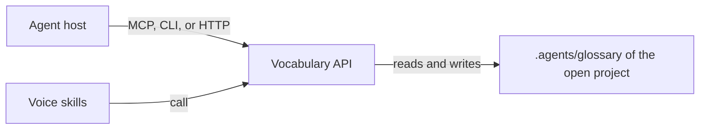

# Architecture Overview

This document is the map of this repository. The glossary of a project stays in that project. This repository is the engine that reads and writes it, and the skills that teach an agent to register terms and to write in that project's voice.

## 1. Project Structure

```text
vocabulary/
├── api/
│   ├── cli.ts                 # Writes glossary terms from the command line
│   ├── mcp/                   # MCP server and the launcher a host can call
│   ├── routes/                # One HTTP endpoint per directory
│   └── shared/                # Glossary access, Zod schemas, HTTP server
├── dist/                      # JavaScript compiled from api/ for an installed copy
├── .agents/skills/            # definir-vocabulario and redigir-com-tom-de-voz
├── docs/
│   ├── adr/                   # Architecture decisions
│   └── runbooks/              # Setup steps for MCP hosts
├── examples/mcp.json          # Server list a project copies
├── .mcp.json                  # Starts the server from this source tree
├── tsconfig.build.json        # Compiles api/ to dist/
├── AGENTS.md                  # Instructions for work in this repository
├── CONTRIBUTING.md            # Commits, CI, releases
├── release-please-config.json # Release Please for this package
└── package.json
```

## 2. High-Level System Diagram



## 3. Core Components

### 3.1. Frontend

None. An agent calls the MCP tools, the CLI, or the local HTTP server.

### 3.2. Backend Services

#### 3.2.1. Vocabulary API, CLI, and MCP

- Name: `vocabulary`
- Description: Looks up a term, reports which tokens of a text exist, classifies a term or a text, and inserts or updates glossary rows.
- Technologies: TypeScript on Node.js 24, Zod. The type check is TypeScript 7, as `docs/adr/0005-typecheck-with-typescript-7.md` decides.
- Deployment: `node api/mcp/index.ts` from this repository, or `node node_modules/vocabulary/dist/mcp/index.js` from a project that installed it. Node.js does not strip types under `node_modules`, so an installed copy runs the compiled `dist/`, as `docs/adr/0006-ship-compiled-javascript.md` decides. The HTTP server listens on 127.0.0.1.

#### 3.2.2. Voice skills

- Name: `definir-vocabulario` and `redigir-com-tom-de-voz`
- Description: Register glossary terms, and write in the voice of the project that is open. The catalog is `.agents/skills/FEATURES.md`.
- Technologies: Markdown skills, checked by the harness
- Deployment: `npx skills add jimmyandrade/vocabulary` from the project that holds the glossary

## 4. Data Stores

### 4.1. Files in the open project

- Name: Brand glossary
- Type: One UTF-8 JSON file per language
- Purpose: The project owns the terms. This repository ships no glossary.
- Key Schemas/Collections: `.agents/glossary/<language>.json`, or the directory in `HARNESS_GLOSSARY_DIR`

## 5. External Integrations / APIs

None. Crowdin and Transifex are an export, not this file format.

## 6. Deployment & Infrastructure

- Cloud Provider: GitHub
- CI/CD Pipeline: `.github/workflows/ci.yml` typechecks, checks that `dist/` matches `npm run build`, and runs `npm test`, which starts the server from an installed copy. `.github/workflows/release-please.yml` opens the release pull request, and merging it tags `vMAJOR.MINOR.PATCH`. Details are in `CONTRIBUTING.md`. `.github/workflows/skill-check.yml` checks the skills with the harness action.

## 7. Security Considerations

- Authentication: The server trusts the host that starts it. It does not take a token.
- Data Encryption: The glossary is a file in the project.

## 8. Development & Testing Environment

- Setup: `README.md`, section "Work in this repository"
- Testing frameworks: `node --test`, as the harness decided for its TypeScript
- Code quality tools: `tsc --noEmit`, as `docs/adr/0005-typecheck-with-typescript-7.md` decides
- Build: `npm run build` writes `dist/`, which is committed

## 9. Future Considerations / Roadmap

- None recorded.

## 10. Project Identification

- Project Name: vocabulary
- Repository URL: https://github.com/jimmyandrade/vocabulary
- Primary Contact/Team: Jimmy Andrade
- Date of Last Update: 2026-10-13

## 11. Glossary / Acronyms

- Glossary: the per-language list of allowed, forbidden, and situational terms of a project.
- MCP: Model Context Protocol, how an agent calls `lookup_term`, `exists_in_text`, and `write_terms`.
- ADR: Architecture Decision Record, in `docs/adr/`.
