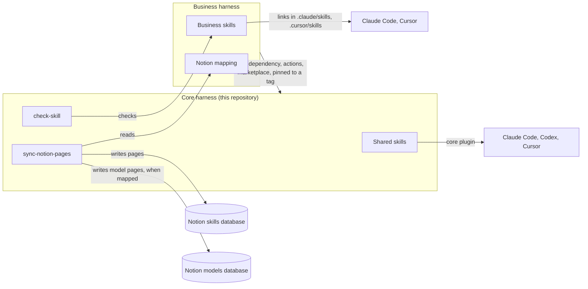

# Architecture Overview

This document is the map of this repository: which files exist, what each part does, and how the parts talk to each other. It is written for agents and people who need to find their way before changing anything. Other documents link here instead of repeating the layout. Update it when a directory, a component, or a boundary changes, not when a skill is added.

This repository is the core harness. A business harness is a separate, private repository that uses it, as decided in `docs/adr/0005-split-the-core-from-business-harnesses.md`.

## 1. Project Structure

```text
harness/
├── .agents/
│   ├── assets/templates/           # Models that skills cite by name when they write a file, published to Notion when the project maps them
│   ├── mappings/                   # Templates of the Notion mappings a business harness copies, for skills and for models
│   ├── schemas/                    # JSON Schema of a skill page, of a model page, and of a person record
│   ├── scripts/
│   │   ├── check-skill/            # Skill checker (Python), run by Lefthook and the check-skill action
│   │   ├── check-models/           # Checks the frontmatter and the sections of each model in assets/templates, run by check-skill
│   │   ├── core-pins/              # Checks that every pin of the core in a project names the same tag, run by check-skill
│   │   ├── plugin-manifests/       # Checks that the Cursor manifest and the Codex-readable marketplace agree with .claude-plugin/, run by check-skill
│   │   ├── project-parameters/     # Reads and validates the parameters in the AGENTS.md frontmatter, for every script
│   │   ├── skill-graph/            # Writes .agents/skills/README.md, the Mermaid graph of skills
│   │   ├── skill-folder-icon/      # macOS folder icon for each skill, run by Lefthook in the checker's virtual environment
│   │   └── sync-notion-pages/      # Notion sync (TypeScript), run by the sync-notion-pages action: one module per page kind, on shared modules
│   └── skills/                     # Shared skills, one <name>/SKILL.md each
│       ├── FEATURES.md             # One entry per skill, written by hand
│       └── README.md               # Generated skill graph; do not edit
├── .claude-plugin/                 # Plugin core and the harness marketplace, read by Claude Code and Codex
├── .cursor-plugin/                 # Cursor manifest of the core plugin, kept equal to .claude-plugin/plugin.json
├── .github/
│   ├── actions/                    # Composite actions called by business harnesses
│   │   ├── check-branch-name/
│   │   ├── check-duplicate-pull-request/
│   │   ├── check-skill/
│   │   └── sync-notion-pages/
│   ├── scripts/                    # Scripts the workflows of this repository call
│   └── workflows/                  # CI and Release Please for this repository
├── docs/
│   ├── adr/                        # Architecture decisions
│   └── runbooks/                   # Setup steps, one runbook per tool
│       └── images/                 # Screenshots of the runbooks, one folder per runbook, with no personal data
├── examples/                       # Files the runbooks copy into a project, pinned as vX.Y.Z
├── vocabulary/                     # Vocabulary engine: API, CLI, and MCP server of the glossary
│   ├── api/
│   │   ├── cli.ts                  # Reads and writes glossary terms from the command line
│   │   ├── mcp/                    # MCP server and launch.sh, which the core plugin runs
│   │   ├── routes/                 # One HTTP endpoint per directory
│   │   └── shared/                 # Glossary access, Zod schemas, HTTP server, and test helpers
│   ├── dist/                       # JavaScript compiled from api/ on install, not committed
│   ├── docs/
│   │   ├── adr/                    # Decisions of the engine, numbered apart from docs/adr
│   │   └── runbooks/               # MCP hosts and glossary migration
│   ├── examples/mcp.json           # Server list a project copies
│   ├── schemas/                    # JSON Schema of each glossary file format, one file per version
│   ├── tsconfig.build.json         # Compiles api/ to dist/
│   └── types.ts                    # Type declarations business harnesses import
├── default.json                    # Renovate preset extended by business harnesses
├── lefthook.yml                    # Pre-commit checker for this repository
├── AGENTS.md                       # Rules for agents working here
├── ARCHITECTURE.md                 # This map
├── CONTRIBUTING.md                 # Commits, CI, actions, releases
├── FEATURES.md                     # Tools a person or a repository uses directly
├── INSTALL.md                      # Index of the runbooks
├── SECURITY.md                     # Supported runtimes, secrets, reporting
└── TROUBLESHOOTING.md              # Failure diagnosis
```

A business harness has the same `.agents/` layout with its own skills, mappings, and glossary, and `node_modules/harness` holding a pinned release of this repository. The vocabulary engine is in `vocabulary/` in this repository, as ADR 0018 decides, and a business harness reads it from `node_modules/harness/vocabulary`. The vocabulary module also exports a reusable MCP server HTTP utilities library (`vocabulary/api/shared/mcp-http.ts`) and type declarations (`vocabulary/types.ts`). The protocol types and the HTTP transport come from `@modelcontextprotocol/sdk`. The library keeps the body size limit, CORS header fields, the write-tool gate, and the bearer token check. `Forma do harness` chooses a business harness repository, an install inside a repository that already exists, or both, with the other repositories installing that business harness and the core. A repository whose install is `global` uses the plugin already installed in the tool and receives no dependency, skills link, or plugin files of its own. None of these choices decides where the glossary lives. `INSTALL.md` has the table.

## 2. High-Level System Diagram



## 3. Core Components

### 3.1. Frontend

None. People reach the core through their agent (Claude Code, Cursor), GitHub, and Notion.

### 3.2. Backend Services

#### 3.2.1. Skill checker

- Name: `check-skill`
- Description: Checks each changed `SKILL.md` against the harness rules and the settings in the project `AGENTS.md`, including related skills, Gherkin files, and the skill graph.
- Technologies: Python 3.14
- Deployment: Lefthook on commit; composite action in CI

#### 3.2.2. Notion sync

- Name: `sync-notion-pages`
- Description: Creates or updates one Notion page per changed skill, through the caller's mapping, the page of the project instructions when they change, and one page per changed model, through the caller's model mapping when it has one.
- Technologies: TypeScript on Node.js 24, `@notionhq/client`
- Deployment: Composite action on each release of a business harness
- Modules: `sync-notion-pages.ts` is the entry point that decides what to publish. `skill-pages.ts` writes the skill pages and the project instructions page, and `template-pages.ts` writes the model pages. They share `notion.ts` (API shape, properties, icon, status, title lookup), `frontmatter.ts`, and `project.ts` (project and core roots, git changes). A new kind of page is one more module next to them, called from the entry point.

#### 3.2.3. Plugin

- Name: `core`
- Description: Ships the shared skills to Claude Code, Codex, and Cursor, as `docs/adr/0011-publish-the-plugin-to-codex-and-cursor-from-the-claude-code-manifests.md` decides. In Claude Code it also starts the vocabulary server through `vocabulary/api/mcp/launch.sh`, as `docs/adr/0019-start-the-vocabulary-server-from-the-core-plugin.md` decides.
- Technologies: `.claude-plugin/plugin.json`, read by Claude Code and Codex; `.cursor-plugin/plugin.json`, read by Cursor
- Deployment: Marketplace `harness` in this repository, or a business marketplace that lists it with a `url` source pinned to a tag; in Cursor, a team marketplace imported from this repository. A personal dashboard list and Grok Bot do not load it. The steps are in `docs/runbooks/cursor.md`

#### 3.2.4. Vocabulary API, CLI, and MCP

- Name: `vocabulary`
- Description: Looks up a term, reports which words of a text exist, classifies a term or a text, inserts, updates, or deletes glossary rows one by one or in a batch, lists every problem of a refused batch at once, tests a batch with a dry run that writes nothing, migrates rows that use a deprecated level, and reports its own version.
- Technologies: TypeScript on Node.js 24, Zod, as `vocabulary/docs/adr/0004-validate-the-api-with-zod.md` decides. The type check is TypeScript 7, as `vocabulary/docs/adr/0005-typecheck-with-typescript-7.md` decides.
- Deployment: the `core` plugin in Claude Code, through `vocabulary/api/mcp/launch.sh`; `node node_modules/harness/vocabulary/dist/mcp/index.js` from a project that installed the package, as every other host does. Node.js does not strip types under `node_modules`, so `prepare` compiles `dist/` on install, as `vocabulary/docs/adr/0007-build-on-install.md` decides.
- Shared pieces: each lives in one place, and a new route test or check uses it instead of repeating it. The host of the HTTP server is `HOST`, in `vocabulary/api/shared/http.ts`. A route test starts the server with `withServer`, from `vocabulary/api/shared/testing.ts`, which stays out of the build. The checks of a write compose in `guarded`, in `vocabulary/api/shared/schema.ts`, and the real link check lives in `vocabulary/api/shared/links.ts`.

## 4. Data Stores

### 4.1. Files in git

- Name: Skills, models, configuration, mappings
- Type: Markdown, YAML, and JSON files
- Purpose: Git is the write source of every skill and setting
- Key Schemas/Collections: `.agents/skills/<name>/SKILL.md`, `.agents/assets/templates/<name>.md`, `AGENTS.md` and the parameters in its frontmatter, `.agents/mappings/skill-page.notion.json`, `.agents/mappings/template-page.notion.json`

### 4.2. Notion

- Name: Skills database of each business
- Type: Notion data source
- Purpose: Readable copy of the skills for the people of that workspace; only the sync writes it

- Name: Models database of each business, optional
- Type: Notion data source
- Purpose: Readable copy of the models, as ADR 0012 and ADR 0015 decide; the sync writes the mapped properties and the body, and people keep the other properties

### 4.3. Glossary files

- Name: Brand glossary of each project
- Type: One UTF-8 JSON file per language
- Purpose: The project owns its terms. This repository ships no glossary
- Key Schemas/Collections: `.agents/glossary/<language>.json` of the open project, or the directory in `HARNESS_GLOSSARY_DIR`. The format is in `$schema` and in `vocabulary/schemas/`, as `vocabulary/docs/adr/0003-store-the-brand-glossary-as-json.md` and `vocabulary/docs/adr/0018-version-the-glossary-file-format.md` decide

## 5. External Integrations / APIs

- Notion API: Purpose: publish skill and model pages. Integration Method: `@notionhq/client` with the business token.
- GitHub: Purpose: pull requests, CI, releases, and composite actions. Integration Method: GitHub Actions and the `gh` CLI.
- Renovate: Purpose: move the pins of the core in business harnesses. Integration Method: the preset in `default.json`.

## 6. Deployment & Infrastructure

- Cloud Provider: GitHub
- Key Services Used: GitHub Actions, GitHub Releases
- CI/CD Pipeline: `.github/workflows/ci.yml` checks and tests; Release Please tags each release. Details are in `CONTRIBUTING.md`.
- Monitoring & Logging: GitHub Actions logs and job summaries

## 7. Security Considerations

- Authentication: The Notion token is a secret of each business harness, passed to the sync action.
- Authorization: The Notion integration sees only the skills database shared with it.
- Data Encryption: Delegated to GitHub secrets and the Notion API over HTTPS.
- Vocabulary server: listens only on `127.0.0.1` and trusts the host that starts it. It takes no token. A business harness that serves it over HTTP adds the bearer token check of `vocabulary/api/shared/mcp-http.ts`.
- Key Security Tools/Practices: This repository is public and holds no token, workspace, database, or business name. Details are in `SECURITY.md`.

## 8. Development & Testing Environment

- Setup: `INSTALL.md`, section "Work in this repository"
- Testing frameworks: `node --test` for TypeScript, as decided in `docs/adr/0006-test-with-the-node-test-runner.md`; Python test scripts for the checker and the graph
- Code quality tools: `tsc --noEmit`, the skill checker, Lefthook
- Build: `npm run build` writes `vocabulary/dist/`. `npm ci` and an install from git run it through `prepare`

## 9. Future Considerations / Roadmap

- Move the remaining shared skills from business harnesses after their audit.
- Keep the Renovate preset moving every pin, including `.claude/settings.json`.

## 10. Project Identification

- Project Name: haRness (core)
- Repository URL: https://github.com/jimmyandrade/harness
- Primary Contact/Team: Jimmy Andrade
- Date of Last Update: 2026-10-30

## 11. Glossary / Acronyms

- Core harness: this repository, shared by every business.
- Business harness: a private repository with the skills and data of one business.
- Skill: a `SKILL.md` with instructions an agent loads for one kind of task.
- Mapping: the JSON file that names the Notion data source, properties, and status options of one business.
- Glossary: the per-language list of the terms of a business, each rated on five levels from forbidden to allowed. It can live in the open repository or only on the computer. The engine that reads it is in `vocabulary/` in this repository. The glossary directory is not the harness.
- Marketplace: the catalog that lists plugins to install. Claude Code and Codex read `.claude-plugin/marketplace.json`. Cursor has no marketplace file in this repository: a team imports the repository, and that import follows a branch. A personal list in the dashboard is not that import.
- MCP: Model Context Protocol, how an agent calls the vocabulary tools, such as `lookup_term`, `write_terms`, and `get_version`.
- ADR: Architecture Decision Record, in `docs/adr/` for the core and in `vocabulary/docs/adr/` for the engine.
