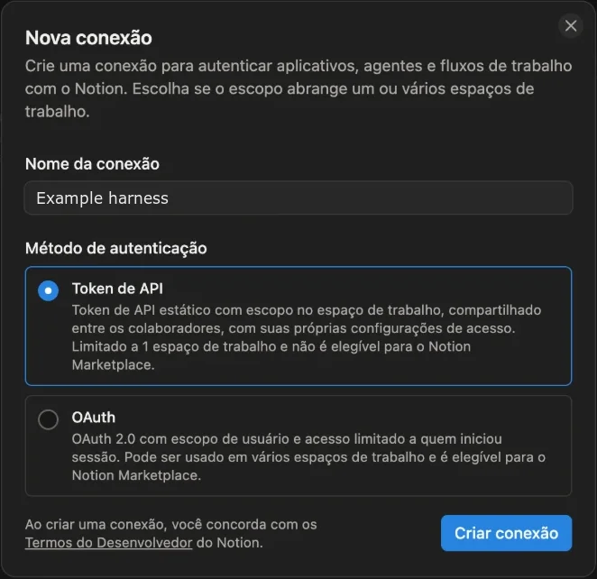
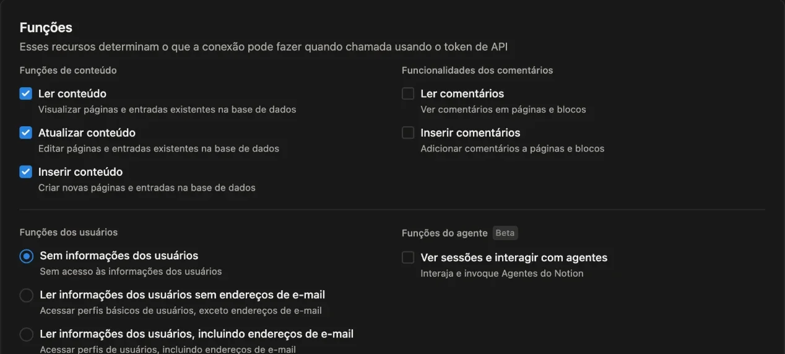
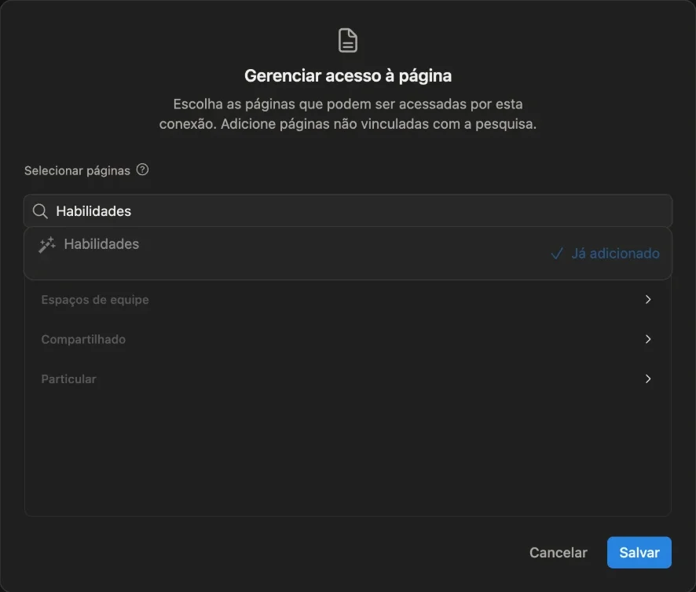
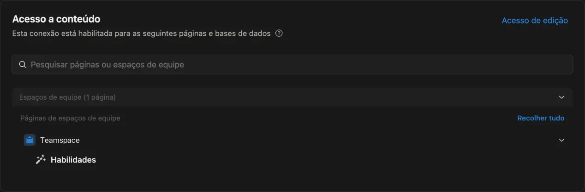

# Publish the skills in Notion

GitHub is the write source. On each release, the sync action writes one page per skill changed since the previous release, including the core skills, into the skills database of the workspace, and one page for the project instructions, `AGENTS.md`, when that file changes. Nobody edits those pages in Notion. The database can have any name; businesses in Brazil often call it Habilidades. Run this runbook from the root of the business repository, after [`business-repository.md`](business-repository.md), with `TAG` from [Read the core release](business-repository.md#read-the-core-release). Move the core pin to that release first: a business repository that pins an old core has an old copy of this runbook and of `examples/notion/`.

Each step ends with a check.

## Write the mapping

```bash
mkdir -p .agents/mappings
cp -n node_modules/harness/.agents/mappings/skill-page.notion.example.json .agents/mappings/skill-page.notion.json
```

Rename a property or a status option when the database uses another name. The mapping has no data source id: the secret of [Store the data source id](#store-the-data-source-id) carries it, as [ADR 0023](../adr/0023-keep-the-notion-data-source-id-in-a-secret.md) decides. The status follows the version: below 0.1.0 is `draft`, from 0.1.0 with major 0 is `validation`, from 1 onward is `production`.

Check: every value under `properties` and `status_options` names a property or an option of that data source.

## Create a connection for the sync

Create a Notion connection used only by the sync. Do not reuse one that a website, an automation, or a person also uses: a leaked token then reaches only the skills database, the token can be rotated alone, and page history names the sync as the editor.

In Notion, open the workspace of the skills database. In the sidebar, under Developer, open Connections, and select New connection. In Portuguese the path is Desenvolvedor, Conexões, Nova conexão. Older versions of Notion had the same page at notion.so/profile/integrations.

Name the connection after the harness, since the name shows as the editor of each page. Choose the API token method (an internal integration, Token de API in Portuguese), not OAuth, and create the connection.



The connection opens on its Configuration tab. Under Capabilities, set each one as below; each change saves by itself. Notion selects user information including email addresses by default, so change it.

| Capability | In Portuguese | Value |
|---|---|---|
| Read content | Ler conteúdo | on |
| Update content | Atualizar conteúdo | on |
| Insert content | Inserir conteúdo | on |
| Read comments, insert comments | Ler comentários, inserir comentários | off |
| User information | Funções dos usuários | No user information (Sem informações dos usuários) |
| Agent capabilities, beta | Funções do agente | off |



The sync queries the data source, creates pages, and updates them. It never deletes a page and never reads people, comments, or other pages.

Open the Content access tab (Acesso a conteúdo) and select Edit access. Search for the skills database by name and select it, so it shows as already added. Select only the database, not the page or the teamspace that contains it, which would grant everything under it. A custom icon can hide which result is the database: open it in Notion, and the database shows its properties as columns, while a page that holds it shows the database inside. Then save. If another connection had access to the skills database, remove it there.



The tab groups pages by teamspace. The teamspace is only the group, not a grant: the header counts one page. Select Expand all to see the database under it.



Check: with every group expanded, the Content access tab lists the skills database and nothing else.

## Store the token

Copy the token with the copy button under Integration token (Token de integração), in the Configuration tab of the connection, without revealing it on screen. The copy button is the last icon of the field; the one beside it generates a new token and voids the old one. Notion says "Link copied" (Link copiado) even when it copies the token.

Never paste the token into a chat, an issue, or a pull request. A Notion token starts with `ntn_` and has 50 characters.

Test the token in the clipboard before storing it. A search answers `200` when the token is valid, even before it reaches any page, and `401` when the clipboard holds something else or the token was generated again. The content access check above is what confirms the skills database.

```bash
curl -s -o /dev/null -w "%{http_code}\n" -X POST https://api.notion.com/v1/search -H "Authorization: Bearer $(pbpaste)" -H "Notion-Version: 2022-06-28" -H "Content-Type: application/json" -d '{"page_size":1}'
```

Store the tested token as the repository secret `NOTION_TOKEN` straight from the clipboard, so nothing else is pasted in its place and the token never shows in the shell history. Then clear the clipboard.

```bash
pbpaste | gh secret set NOTION_TOKEN
pbcopy < /dev/null
```

`pbpaste` and `pbcopy` are on macOS. Elsewhere, run `gh secret set NOTION_TOKEN`, which asks for the value, and check that it shows 50 masked characters.

Generating a new token voids the one stored in `NOTION_TOKEN`. After that, test and store the new one the same way.

Check: the search answers `200`, and `gh secret list` shows `NOTION_TOKEN` with the time it was just set, in UTC.

## Store the data source id

The sync reads the id of the skills data source from the `NOTION_SKILLS_DATA_SOURCE_ID` secret. The id alone grants nothing without the token, but it stays out of the repository and its history, next to the token, as [ADR 0023](../adr/0023-keep-the-notion-data-source-id-in-a-secret.md) decides.

With the token in the clipboard, as in [Store the token](#store-the-token), read the id from the database. Take the database id from its link: the 32 characters before `?v=`. The command prints only the data source id and its name.

```bash
curl -s https://api.notion.com/v1/databases/<database id> -H "Authorization: Bearer $(pbpaste)" -H "Notion-Version: 2025-09-03" | python3 -c 'import json,sys; [print(d["id"], d.get("name")) for d in json.load(sys.stdin).get("data_sources", [])]'
pbcopy < /dev/null
```

Store it as a secret of the repository. The command asks for the value.

```bash
gh secret set NOTION_SKILLS_DATA_SOURCE_ID
```

A repository that keeps `data_source_id` in its mapping must migrate: store the id as the secret, delete `data_source_id` from the mapping, and pass the secret to the `skills-data-source-id` input, as the example workflow does, in one pull request. Until then, each sync prints a warning with these steps; with the id in both places, the sync fails.

Check: `gh secret list` shows `NOTION_SKILLS_DATA_SOURCE_ID`, the mapping has no `data_source_id`, and the sync log has no warning about it.

## Copy the sync workflow

The `sync-skills` workflow publishes the skills that changed since the previous release. It checks them first, so a skill that breaks a rule never reaches Notion. It runs when a release is published and by hand from the Actions tab, where `base` publishes the changes since another commit or tag, to test a skill in Notion before a release.

```bash
cp -Rn node_modules/harness/examples/notion/. .
perl -pi -e "s/vX\.Y\.Z/$TAG/g" .github/workflows/sync-skills.yml
```

A repository whose `skill-pages` workflow syncs on each push to `main` deletes `.github/workflows/skill-pages.yml`, so a merge no longer publishes before the release.

With Release Please, create the release with the token of a GitHub App, as `examples/release-please/.github/workflows/release-please.yml` does. A release that `GITHUB_TOKEN` creates fires no `release` workflow, so the sync would not run, and GitHub holds the `pull_request` checks of the release pull request it opens until someone approves them. Install the app only on the business repository, with Contents, Pull requests, and Issues read and write, store its client ID as the variable `RELEASE_APP_CLIENT_ID` and a private key as the secret `RELEASE_APP_PRIVATE_KEY`, and pass the token to the Release Please step. A Release Please workflow that still calls `sync-skills.yml` in a job of its own drops that job when it moves to the app token, or the release syncs twice. Without Release Please, publishing a release by hand fires the workflow.

Check: after a release that changes one skill, the sync step log has one line, `create` or `update`, and the page shows the new version. After a release that changes `AGENTS.md`, the log has a line for `AGENTS.md`, and the skills database has a page with that title. If the workspace already had a page titled `AGENTS.md` outside the skills database, archive it by hand, so the Notion agent reads only the synced one. An `object_not_found` error that asks to share the data source with the integration means the connection of [Create a connection for the sync](#create-a-connection-for-the-sync) has no access to the skills database.

## Publish the models, optional

Skip this step when the workspace keeps no models in Notion. A model is a file in `.agents/assets/templates/` with `name`, `description`, and `metadata.version` in its frontmatter, as ADR 0012 decides. Without the model mapping, the sync publishes no model.

```bash
cp -n node_modules/harness/.agents/mappings/template-page.notion.example.json .agents/mappings/template-page.notion.json
```

Store the id of the models data source as the `NOTION_TEMPLATES_DATA_SOURCE_ID` secret, as in [Store the data source id](#store-the-data-source-id). `name` and `version` are required. The models database may lack some of the other properties: remove `description`, `aliases`, `tags`, or `status` from the mapping only when the database has no such property, because the sync writes every property the mapping names, and Notion rejects a write to a property that does not exist. A removed property is left out of the page, and a property the mapping does not bind, such as a reviewer, keeps what people set. In the access tab of the connection of [Create a connection for the sync](#create-a-connection-for-the-sync), add the models database. Set `Banco de modelos no Notion` in the `Global` entry of `metadata.parameters` of `AGENTS.md` to the link of that database, so the Notion agent finds a model a skill cites by name.

A page that a person created before the sync, under another title, is replaced when the model lists that title in `metadata.aliases`. Its body becomes the file body on the first sync, so move what it still has into the file first.

Check: after a release that changes one model, the sync step log has a `create template` or `update template` line, and the page shows the new version.
